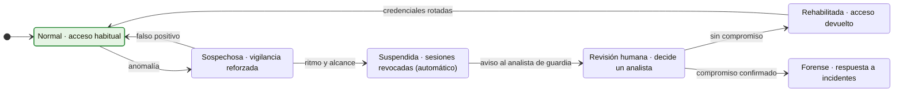
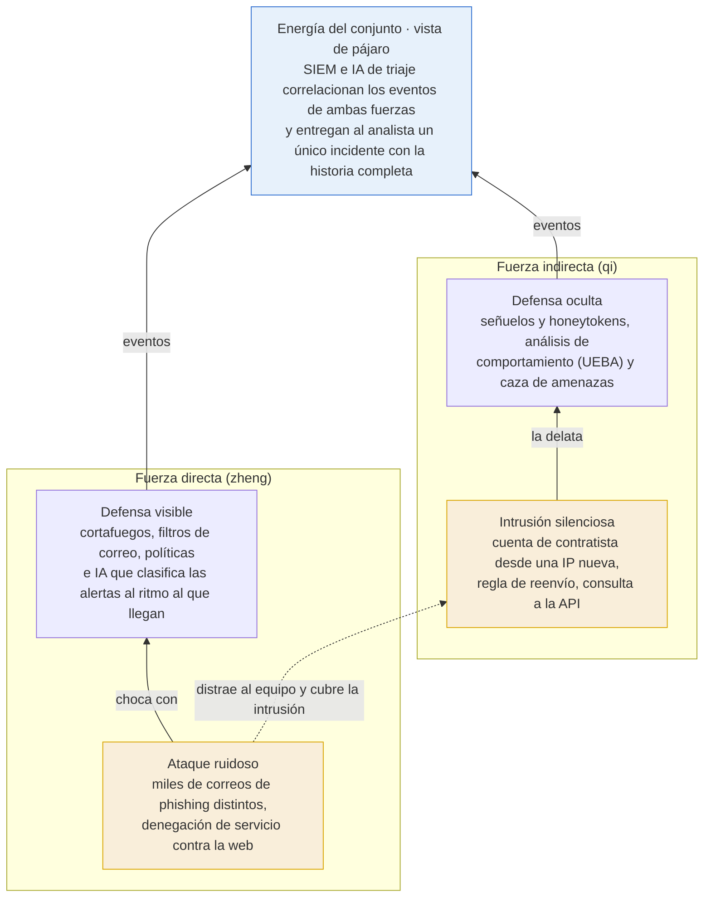
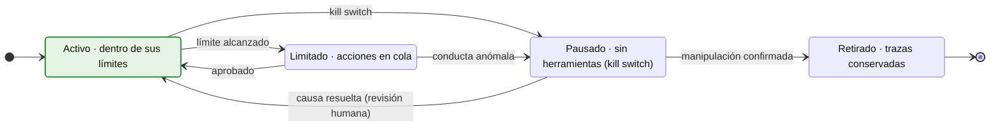
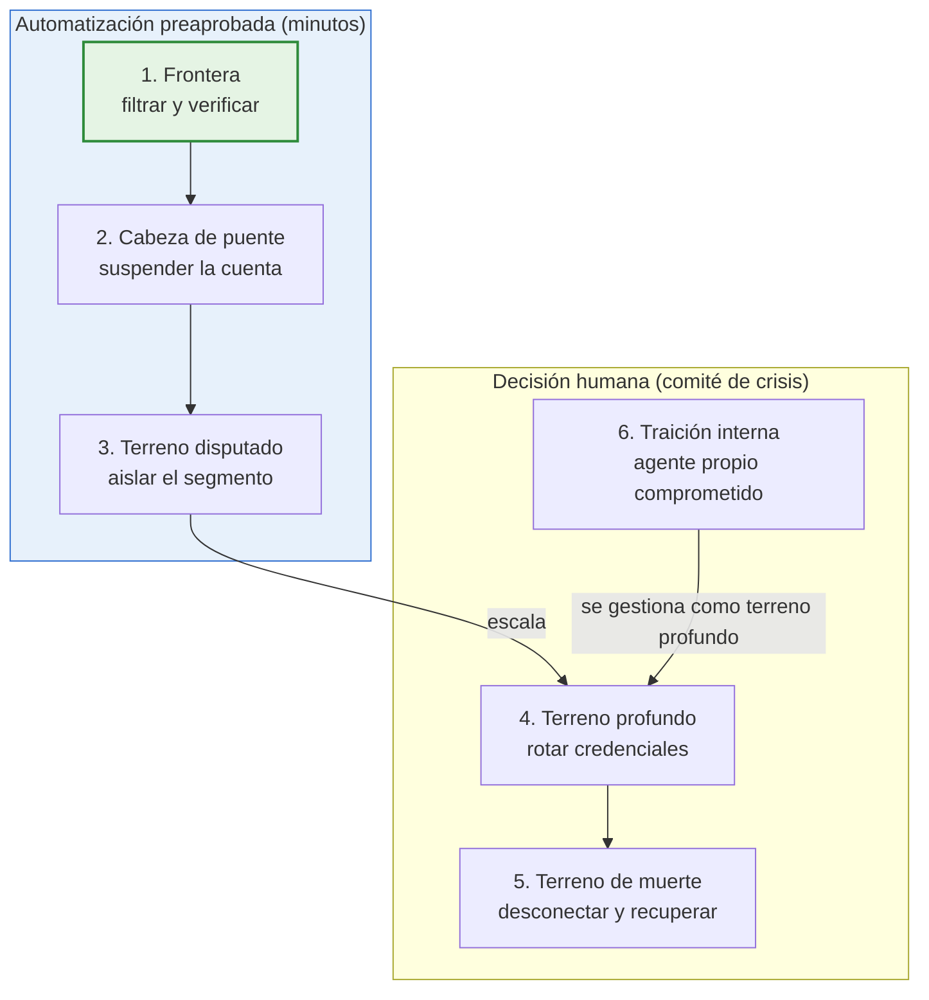
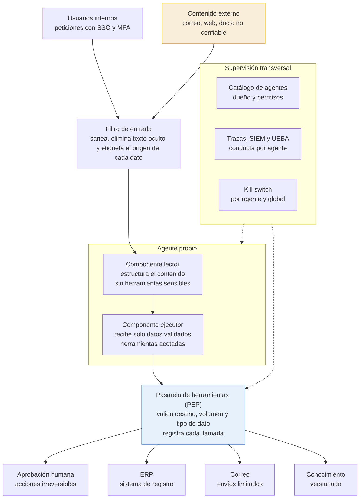
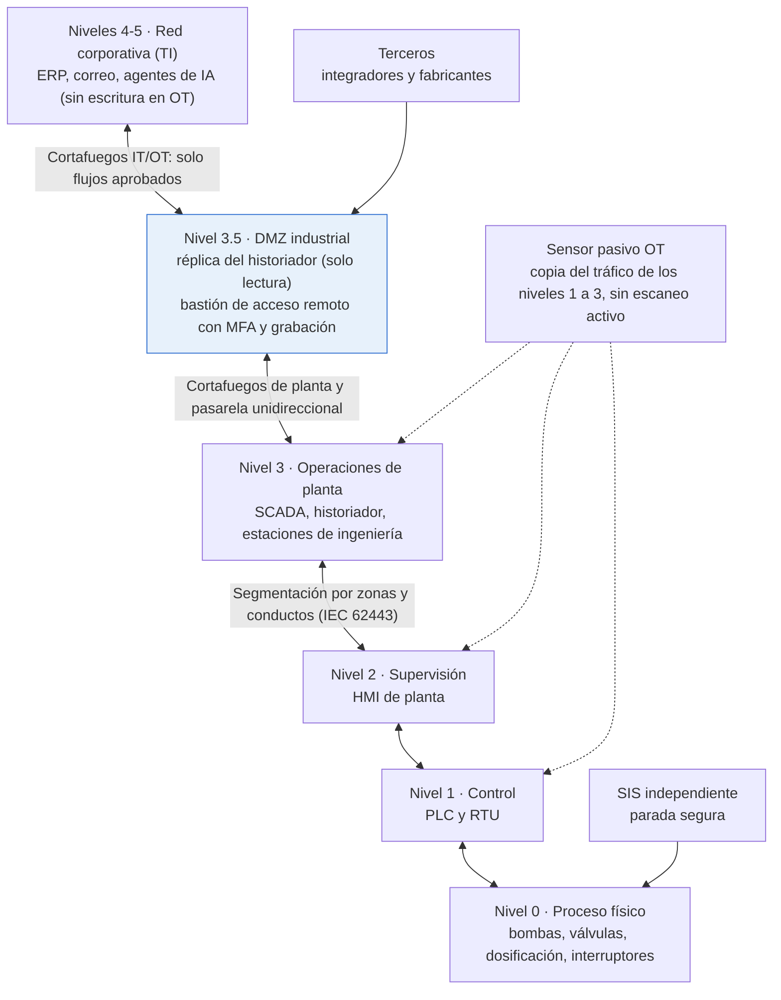
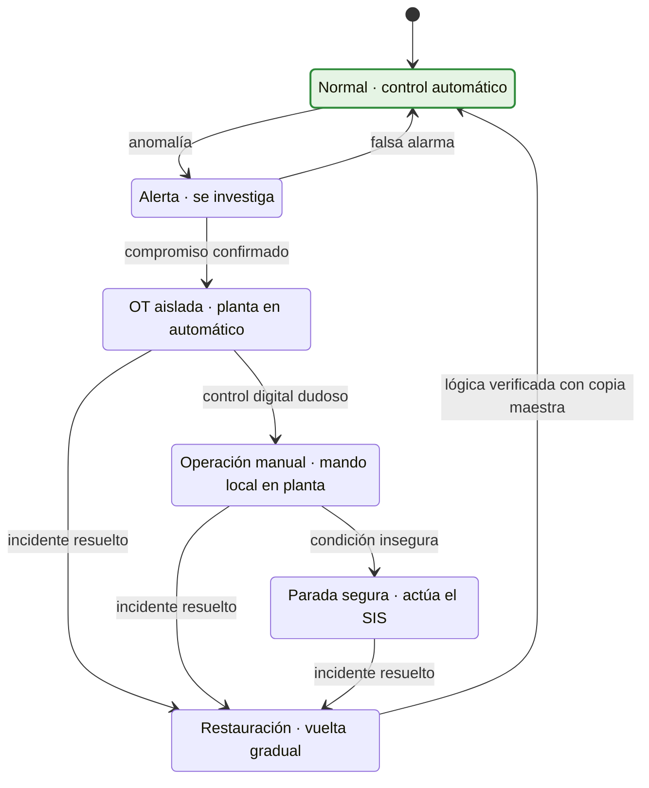

# El arte de la ciberguerra

*Sun Tzu adaptado a la defensa frente a agentes de ataque con IA — borrador preliminar, versión 3*

25 de octubre de 2026

**Novedades de la versión 3:** cita breve del texto original al inicio de cada capítulo, un caso real documentado por capítulo, Anexo C de bibliografía y Anexo D con el glosario de acrónimos. La versión 2 añadió los diagramas de estado de los capítulos 2, 8 y 11 y el Anexo B sobre infraestructuras críticas.

> Los diagramas están en formato Mermaid: se visualizan en GitHub, GitLab, Obsidian, VS Code y la mayoría de editores Markdown.

**Licencia:** [CC BY-SA 4.0](https://creativecommons.org/licenses/by-sa/4.0/deed.es). Detalles, contenido de terceros y aviso de responsabilidad en la sección «Licencia y avisos», al final del documento.

## Índice

- [Resumen](#resumen)
- [Introducción](#introducción)
- Capítulos
  - [1. Evaluación y planes](#capítulo-1-evaluación-y-planes): inventario de identidades no humanas
  - [2. El coste de la guerra](#capítulo-2-el-coste-de-la-guerra): contención automática
  - [3. La estrategia del ataque](#capítulo-3-la-estrategia-del-ataque): verificación frente a la suplantación con IA
  - [4. Las disposiciones](#capítulo-4-las-disposiciones): agentes propios con mínimo privilegio
  - [5. La energía](#capítulo-5-la-energía): IA defensiva y correlación
  - [6. Lo lleno y lo vacío](#capítulo-6-lo-lleno-y-lo-vacío): superficie de ataque, incluida la de IA
  - [7. La maniobra](#capítulo-7-la-maniobra): mitigación sin parche y crisis autenticada
  - [8. Las nueve variables](#capítulo-8-las-nueve-variables): límites a la automatización
  - [9. El ejército en marcha](#capítulo-9-el-ejército-en-marcha): detección por ritmo y alcance
  - [10. El terreno](#capítulo-10-el-terreno): segmentación y entornos acotados para agentes
  - [11. Las nueve situaciones](#capítulo-11-las-nueve-situaciones): fases de un incidente y quién decide
  - [12. El ataque con fuego](#capítulo-12-el-ataque-con-fuego): envenenamiento de datos y resiliencia
  - [13. El uso de espías](#capítulo-13-el-uso-de-espías): señuelos y vigilancia de agentes propios
- [Arquitectura de referencia](#arquitectura-de-referencia)
- [Limitaciones de este borrador](#limitaciones-de-este-borrador)
- Anexos
  - [A. Correspondencias y ejercicios](#anexo-a-correspondencias-y-ejercicios)
  - [B. Infraestructuras críticas: agua, electricidad y gas](#anexo-b-infraestructuras-críticas-agua-electricidad-y-gas)
  - [C. Bibliografía](#anexo-c-bibliografía)
  - [D. Glosario de acrónimos](#anexo-d-glosario-de-acrónimos)
- [Sobre la autoría](#sobre-la-autoría)
- [Licencia y avisos](#licencia-y-avisos)

## Resumen

Este documento adapta los trece capítulos de *El arte de la guerra* de Sun Tzu a un problema actual: la defensa de una organización frente a agentes de ataque programados con inteligencia artificial. Está dirigido a arquitectos de ciberseguridad, de soluciones y empresariales, y se centra en decisiones de diseño, no en la operación diaria.

La tesis central es que la IA invierte la economía del conflicto. El atacante prueba miles de veces, a velocidad de máquina y a coste casi nulo; el defensor responde con contención automática y preaprobada para lo reversible, decisión humana para lo irreversible y arquitecturas que limitan lo que pueden hacer sus propios agentes, que también pueden ser engañados.

Cada capítulo combina una cita del original, su lectura frente a agentes de IA, un escenario en una empresa ficticia, un caso real documentado, decisiones de arquitectura alineadas con marcos de referencia (NIST CSF 2.0, Zero Trust, MITRE ATT&CK y ATLAS, OWASP Top 10 agéntico) y lecciones aplicables. Se completa con una arquitectura de referencia, diagramas de estado, un anexo sobre infraestructuras críticas (agua, electricidad y gas), bibliografía y glosario.

**Palabras clave:** Sun Tzu, ciberseguridad, agentes de IA, arquitectura de seguridad, Zero Trust, infraestructuras críticas, OT.

## Introducción

El adversario ya no es solo un humano frente a un teclado: cada vez más, es un agente de IA que reconoce, prueba, se adapta y actúa a velocidad de máquina, sin cansarse y a un coste casi nulo. Sun Tzu sigue siendo válido porque sus principios hablan de conflicto entre inteligencias, no de una tecnología concreta.

### Qué cambia con un adversario con IA

| Rasgo | Atacante humano clásico | Agente de ataque con IA |
| --- | --- | --- |
| Velocidad | Horas o días por fase | Segundos o minutos por fase |
| Escala | Pocos objetivos a la vez | Miles de objetivos en paralelo |
| Coste por intento | Alto (tiempo de un experto) | Casi nulo |
| Personalización | Cara; se reserva a objetivos de valor | Masiva: cada correo, voz o mensaje a medida |
| Persistencia | Se cansa, comete errores por fatiga | Incansable y exhaustivo |
| Debilidades | Errores humanos, horarios | Literalidad, dependencia de su infraestructura, se le puede engañar con señuelos |

Hay un segundo frente: **nuestros propios agentes de IA** (asistentes, copilotos, agentes de atención al cliente o de programación) también pueden ser engañados o secuestrados, por ejemplo mediante inyección de instrucciones (prompt injection) escondidas en un correo, una web o un documento.

### Cómo leer este borrador

Este libro está escrito para **arquitectos**: de ciberseguridad, de soluciones y empresariales. No es un manual de operación del SOC, sino una guía para tomar decisiones de diseño que hagan a la organización resistente frente a adversarios automáticos y que permitan desplegar agentes propios sin abrir nuevas brechas.

Cada capítulo tiene cinco partes:

- **El principio**: paráfrasis de las ideas clave, basada en la traducción inglesa de Lionel Giles (1910, dominio público).
- **Lectura frente a agentes de IA**: qué significa hoy.
- **Escenario**: un caso práctico en una empresa ficticia, *Grupo Meridiano* (distribución, 1.200 empleados, sedes en Madrid y Valencia, servidores propios y nube, y varios agentes de IA en producción).
- **Decisiones de arquitectura**: las decisiones de diseño que plantea el capítulo, el patrón recomendado, su compromiso (coste, complejidad, fricción) y su encaje en marcos de referencia.
- **Lecciones**: lo que se puede aplicar el lunes.

Cada capítulo se abre con una cita breve del original, traducida al español a partir de la versión inglesa de Lionel Giles (1910, dominio público), e incluye un **caso real** público y documentado, con su fuente.

Marcos de referencia usados: NIST CSF 2.0, Zero Trust (NIST SP 800-207), MITRE ATT&CK y MITRE ATLAS, OWASP Top 10 para aplicaciones agénticas (riesgos ASI01-ASI10), NIST AI RMF e ISO/IEC 42001.

### Cómo leerlo según el rol

| Rol | Foco principal | Capítulos clave |
| --- | --- | --- |
| Arquitecto de ciberseguridad | Controles, detección, respuesta, patrones Zero Trust | 2, 4, 5, 9, 11, 13 |
| Arquitecto de soluciones | Diseño seguro de agentes, integraciones, datos que los alimentan | 4, 6, 8, 10, 12 |
| Arquitecto empresarial | Gobierno, capacidades, inventario, riesgo y principios de arquitectura | 1, 3, 7, 8, 11 |

El enfoque es defensivo: se describe cómo piensa y actúa un agente atacante para poder detectarlo y frenarlo, sin detallar técnicas de ataque.

## Capítulo 1. Evaluación y planes

> «El arte de la guerra es de vital importancia para el Estado.»
>
> — Sun Tzu, capítulo I

### El principio

La guerra es asunto vital para el Estado y debe estudiarse antes de librarla. Sun Tzu propone comparar a los dos bandos en cinco factores: la ley moral (la cohesión), el cielo (las condiciones), la tierra (el terreno), el mando y la disciplina. Quien hace más cálculos antes de la batalla gana; quien hace pocos, pierde. Y añade: toda guerra se basa en el engaño.

### Lectura frente a agentes de IA

Los cinco factores siguen siendo la plantilla de evaluación, pero cada uno tiene ahora una pregunta nueva:

| Factor de Sun Tzu | Equivalente hoy | Pregunta frente a la IA |
| --- | --- | --- |
| Ley moral | Cultura y apoyo de la dirección | ¿La dirección entiende que el ataque es ahora automático y continuo? |
| Cielo | Contexto de amenazas y regulación (NIS2, DORA, Reglamento de IA de la UE) | ¿Qué capacidades de IA ofensiva se están viendo en nuestro sector? |
| Tierra | Activos y superficie expuesta | ¿Tenemos inventariados nuestros propios agentes, sus claves de API y sus permisos? |
| Mando | Gobierno y autoridad en incidentes | ¿Quién decide si se apaga un agente propio que se comporta de forma extraña? |
| Disciplina | Procesos y controles medidos | ¿Nuestros controles reaccionan en minutos o en días? |

El cálculo previo tiene que asumir una asimetría: el atacante con IA prueba miles de veces a coste casi nulo; el defensor solo necesita fallar una.

### Escenario: los agentes que nadie había contado

El nuevo CISO de Grupo Meridiano añade una pregunta al inventario: "¿qué agentes de IA tienen acceso a nuestros sistemas?". Esperaba dos. Encuentra 14: un agente de atención al cliente, un copiloto de programación, varios asistentes conectados al correo y al ERP mediante claves de API personales, y tres herramientas que los departamentos contrataron por su cuenta.

Nueve de esas identidades no humanas no tienen dueño, cuatro usan claves sin caducidad y una tiene permisos de administrador en el ERP "para que funcionara". El CISO presenta tres medidas: registro obligatorio de todo agente con un responsable humano, claves con caducidad y mínimo privilegio, y la autoridad explícita para desconectar cualquier agente en un incidente.

### Caso real: las credenciales olvidadas de los clientes de Snowflake (2024)

En junio de 2024, Mandiant publicó su investigación sobre una campaña que robó datos de unas 165 organizaciones clientes de Snowflake. Los atacantes no vulneraron la plataforma: usaron credenciales robadas por malware de tipo infostealer, algunas de 2020, que nunca se habían rotado y protegían cuentas sin MFA ni listas de redes permitidas ([informe de Mandiant](https://cloud.google.com/blog/topics/threat-intelligence/unc5537-snowflake-data-theft-extortion); resumen en [SecurityWeek](https://www.securityweek.com/snowflake-attacks-mandiant-links-data-breaches-to-infostealer-infections/)).

**Lectura:** el factor "tierra" (saber qué credenciales existen y en qué estado están) era el más débil, y bastó con él.

### Decisiones de arquitectura

| Decisión | Patrón recomendado | Compromiso |
| --- | --- | --- |
| Gobierno de identidades no humanas | Catálogo central de agentes integrado con IAM/IGA: dueño, propósito, permisos, caducidad | Fricción para equipos que despliegan rápido |
| Nivel de autonomía de cada agente | Clasificación en niveles (solo lectura, acción con aprobación, acción autónoma limitada) que fija los controles obligatorios | Revisión de arquitectura por cada agente nuevo |
| Principios de arquitectura | Incorporar al repositorio de principios (por ejemplo, en TOGAF): "ningún agente sin dueño", "el contenido externo es dato, nunca orden" | Hay que hacerlos cumplir en las revisiones |

**Marcos:** NIST CSF 2.0 (GV, ID.AM), NIST AI RMF (Govern, Map), ISO/IEC 42001, OWASP ASI03 (abuso de identidad y privilegios).

### Lecciones

- Inventaría tus identidades no humanas (agentes, claves de API, cuentas de servicio) igual que a tus empleados.
- Evalúa tus defensas pensando en un atacante que no se cansa y que escala sin coste.
- Define quién puede apagar un agente propio, y cómo, antes de necesitarlo.

## Capítulo 2. El coste de la guerra

> «No hay ningún caso de un país que se haya beneficiado de una guerra prolongada.»
>
> — Sun Tzu, capítulo II

### El principio

Una campaña larga agota el tesoro y la moral del ejército. Ningún país se ha beneficiado de una guerra prolongada. Sun Tzu prefiere la victoria rápida, aunque sea imperfecta, a la operación brillante pero lenta, y aconseja alimentarse con los recursos del enemigo.

### Lectura frente a agentes de IA

Sun Tzu pensaba que la guerra larga arruina al que ataca. Con la IA, el coste se ha invertido: para el atacante, una campaña larga es casi gratis, porque el agente trabaja día y noche sin sueldo ni cansancio. Quien se agota ahora es el defensor humano.

La consecuencia es doble. Primero, el defensor no puede ganar por desgaste: necesita **victorias rápidas**, es decir, contención automática en minutos. Segundo, el ciclo de ataque se comprime: entre el acceso inicial y el robo de datos puede pasar menos de una hora, así que un procedimiento que espera la aprobación de un humano a las tres de la mañana llega tarde.

"Alimentarse del enemigo" también cambia: cada intento del agente atacante deja patrones (ritmo, secuencia de acciones, infraestructura) que pueden convertirse en detecciones automáticas en el mismo día.

### Escenario: cuarenta minutos

Un viernes a las 23:10, una cuenta de un proveedor inicia sesión en la VPN de Meridiano. En los siguientes 12 minutos esa cuenta consulta el directorio, prueba accesos a 300 servidores y localiza la base de datos de clientes. Ningún humano trabaja tan rápido ni tan sistemáticamente.

Meridiano había preautorizado acciones automáticas para patrones de este tipo: el sistema de orquestación (SOAR) suspende la cuenta, aísla los dos servidores tocados y despierta al responsable de guardia. A las 23:50, cuando el analista llega, el ataque está contenido. Sin la automatización, la primera persona lo habría visto el lunes.

### Caso real: 29 minutos de margen

El informe global de amenazas de CrowdStrike publicado en marzo de 2026 sitúa en 29 minutos el tiempo medio que tarda un atacante del cibercrimen en pasar del acceso inicial a otros sistemas, un 65 % menos que el año anterior; el caso más rápido fue de 27 segundos. El mismo informe registra un aumento del 89 % en la actividad de adversarios que usan IA ([SecurityBrief](https://securitybrief.co.uk/story/crowdstrike-flags-faster-ai-driven-cyber-attacks-worldwide)).

**Lectura:** con media hora de margen, la contención que espera a una reunión llega tarde.

### Diagrama de estados: contención de una cuenta



*La máquina suspende; solo una persona devuelve el acceso.*

La automatización solo hace el paso reversible: suspender y revocar sesiones. Devolver el acceso o abrir una investigación forense lo decide siempre un analista.

### Decisiones de arquitectura

| Decisión | Patrón recomendado | Compromiso |
| --- | --- | --- |
| Nivel de automatización de la respuesta | SOAR con acciones reversibles automáticas (suspender, aislar, revocar tokens) e irreversibles con aprobación | Falsos positivos que interrumpan el negocio |
| Revocación rápida | Sesiones cortas y revocación centralizada de tokens y claves, incluidas las de agentes, desde un único punto | Más reautenticaciones para los usuarios |
| Latencia de la telemetría | Registros centralizados en minutos, no ingestión por lotes diaria | Coste de ingestión y almacenamiento |

**Marcos:** NIST CSF 2.0 (DE.CM, RS.MI), MITRE ATT&CK para mapear la cobertura de detección.

### Lecciones

- Contra un adversario automático, la contención también debe serlo, al menos en sus primeros pasos.
- Preautoriza por escrito qué puede hacer la automatización sin esperar a un humano (suspender cuentas, aislar equipos) y qué no (borrar, apagar producción).
- Mide tu tiempo de contención en minutos, no en horas: esa es la carrera real.

## Capítulo 3. La estrategia del ataque

> «Si conoces al enemigo y te conoces a ti mismo, no tienes por qué temer el resultado de cien batallas.»
>
> — Sun Tzu, capítulo III

### El principio

Lo mejor es vencer sin combatir. El orden ideal es frustrar los planes del enemigo, luego romper sus alianzas, después atacar su ejército, y como último recurso asediar ciudades. Y la máxima más citada: si conoces al enemigo y te conoces a ti mismo, no temerás el resultado de cien batallas; si solo te conoces a ti, por cada victoria sufrirás una derrota; si no conoces a ninguno, perderás siempre.

### Lectura frente a agentes de IA

**Conocer al enemigo** hoy es conocer cómo se comporta un agente de ataque. Sus fortalezas: velocidad, paralelismo, exploración exhaustiva y personalización masiva (correos, voces y mensajes hechos a medida de cada víctima). Sus debilidades: es literal, a veces inventa resultados que no existen, depende de su infraestructura y de su proveedor de IA, y tiende a tocar todo lo que encuentra, incluidos los señuelos.

**Conocerse a uno mismo** incluye conocer a los propios agentes: qué hacen, qué pueden tocar y qué instrucciones podrían recibir de fuentes externas.

La jerarquía de Sun Tzu se aplica así:

1. **Frustrar sus planes**: anticipar campañas con inteligencia de amenazas y quitarle al atacante lo que le da ventaja (por ejemplo, que una voz clonada baste para autorizar un pago).
2. **Romper sus alianzas**: el agente necesita modelos, servidores y cuentas. Denunciar el abuso a los proveedores de IA, a los CERT y a las fuerzas de seguridad corta su suministro.
3. **Atacar su ejército**: detectar y expulsar al agente dentro de la red.
4. **Asediar ciudades**: recuperarse tras el daño, siempre lo más caro.

### Escenario: la voz del director financiero

Un boletín sectorial avisa de una campaña contra distribuidoras: llamadas con la voz clonada del director financiero, generada a partir de vídeos públicos, que piden pagos urgentes a un "nuevo proveedor". Los correos de apoyo son impecables, sin una sola falta de ortografía.

Antes de recibir la primera llamada, Meridiano cambia el proceso: ningún pago nuevo se autoriza solo por voz, vídeo o correo; se exige confirmación por un segundo canal ya registrado y una palabra clave interna que cambia cada mes. Tres semanas después, una administrativa recibe la llamada. Pide la palabra clave; la "voz" improvisa una excusa y cuelga. Batalla ganada sin combatir.

### Caso real: la videollamada falsa de Arup (2024)

A principios de 2024, un empleado de finanzas de la oficina de Hong Kong de la ingeniería Arup hizo 15 transferencias por unos 25 millones de dólares. Lo convenció una videollamada con supuestos directivos, entre ellos el director financiero, que eran recreaciones generadas con IA. El empleado había sospechado del correo inicial; la videollamada disipó sus dudas ([CNN, vía ABC17](https://abc17news.com/money/cnn-business-consumer/2024/05/16/british-engineering-giant-arup-revealed-as-25-million-deepfake-scam-victim/)).

**Lectura:** ver y oír a alguien ya no es verificarlo; solo un canal independiente frustra el plan.

### Decisiones de arquitectura

| Decisión | Patrón recomendado | Compromiso |
| --- | --- | --- |
| Verificación de transacciones de alto riesgo | Aprobación dentro del sistema de registro, con confirmación por un canal independiente del que trae la petición | Más lentitud en pagos urgentes |
| Autenticación resistente a phishing | FIDO2 / passkeys para todos, obligatorio para administradores | Despliegue y gestión de autenticadores |
| Inteligencia de amenazas operativa | Flujo CTI → reglas de detección (STIX/TAXII), mapeado a ATT&CK y ATLAS | Un equipo que cure y priorice las fuentes |

**Marcos:** MITRE ATT&CK, MITRE ATLAS, NIST CSF 2.0 (ID.RA), OWASP ASI09 (explotación de la confianza humano-agente).

### Lecciones

- Actualiza la formación: la buena ortografía y una voz conocida ya no prueban nada.
- Diseña procesos que no dependan de reconocer a una persona, sino de verificarla por un canal independiente.
- Estudia los informes públicos de abuso de IA que publican los proveedores: describen tácticas reales.

## Capítulo 4. Las disposiciones

> «Los buenos guerreros de la antigüedad se ponían primero fuera de la posibilidad de la derrota.»
>
> — Sun Tzu, capítulo IV

### El principio

Los buenos guerreros primero se hacen invencibles y luego esperan la ocasión de vencer al enemigo. Hacerse invulnerable depende de uno mismo; que el enemigo sea vulnerable depende de él. El vencedor gana primero y combate después; el perdedor combate primero y busca la victoria luego.

### Lectura frente a agentes de IA

No controlas cuándo te atacará un agente, pero sí tu propia postura. La **defensa en profundidad** sigue siendo la base, con dos añadidos.

Primero, frente al agente externo: como prueba sin descanso, cualquier capa débil acabará encontrándose. Ninguna capa puede ser la única. Segundo, frente a nuestros propios agentes: un agente de IA que lee correos, webs o documentos puede recibir instrucciones ocultas en ese contenido (inyección de instrucciones). No podemos garantizar que nunca se deje engañar, así que hay que garantizar que, aunque se engañe, no pueda hacer mucho daño.

Capas para un agente propio:

- **Mínimo privilegio**: solo las herramientas y datos que necesita su tarea.
- **Separar leer de actuar**: el contenido externo se trata como dato, nunca como orden.
- **Humano en el bucle** para acciones irreversibles o sensibles (pagos, envíos externos, borrados).
- **Límites** de volumen, destino y frecuencia en lo que el agente puede hacer.
- **Registro completo** de cada acción para poder auditarla.

### Escenario: el correo con instrucciones ocultas

Meridiano usa un agente de IA que lee los correos de clientes y prepara respuestas. Un día llega un mensaje con texto invisible (blanco sobre blanco) que ordena al agente reenviar las últimas facturas de todos los clientes a una dirección externa.

El agente se confunde e intenta hacerlo, pero choca con las capas: no tiene permiso para enviar adjuntos a dominios externos, cualquier envío fuera de la conversación original requiere aprobación humana, y la acción queda registrada y genera una alerta. El equipo revisa el caso, añade un filtro que elimina texto oculto antes de que el agente lea el correo y documenta el intento como ejercicio interno.

### Caso real: EchoLeak en Microsoft 365 Copilot (2025)

En junio de 2025, Aim Security publicó EchoLeak (CVE-2025-32711, gravedad crítica 9,3). Un correo con instrucciones ocultas hacía que Copilot, al responder después a una consulta legítima del usuario, mezclara ese contenido no confiable con datos internos y los enviara al atacante, sin ningún clic. Microsoft lo corrigió en sus servidores y no se observó explotación real ([The Hacker News](https://thehackernews.com/2025/06/zero-click-ai-vulnerability-exposes.html)).

**Lectura:** es el escenario de este capítulo en un producto real; separar lo que el agente lee de lo que puede hacer no es teoría.

### Decisiones de arquitectura

| Decisión | Patrón recomendado | Compromiso |
| --- | --- | --- |
| Separación de privilegios del agente | Dividir en componentes: el que lee contenido no confiable no tiene herramientas sensibles; el que actúa solo recibe datos ya estructurados y validados | Más complejidad y latencia |
| Punto de aplicación de política | Pasarela de herramientas (por ejemplo, una pasarela MCP) que valida cada llamada contra política: destino, volumen, tipo de dato | Un componente crítico más que operar |
| Aprobación humana | Humano en el bucle para acciones irreversibles, con un resumen claro de lo que se va a ejecutar | Fatiga de aprobación si se abusa |

**Marcos:** OWASP ASI01 (secuestro de objetivos), ASI02 (mal uso de herramientas), ASI03, ASI05 (ejecución de código inesperada); Zero Trust NIST SP 800-207 (PEP/PDP).

### Patrón concreto: la política de la pasarela

Un ejemplo de política declarada como código para el agente de correo de clientes del escenario. La pasarela evalúa cada llamada a una herramienta antes de ejecutarla y rechaza todo lo que la política no permite de forma explícita:

```yaml
agente: atencion-clientes
propietario: direccion-atencion-cliente
caducidad_credenciales: 30d
herramientas:
  leer_correo:
    permitido: true
  responder_correo:
    permitido: true
    destinatarios: solo_remitente_original
    adjuntos: prohibido
  consultar_pedidos:
    permitido: true
    filtro: cliente_del_hilo
    max_registros: 20
  emitir_reembolso:
    permitido: true
    importe_max_eur: 50
    max_por_dia: 20
    por_encima_del_limite: aprobacion_humana
  enviar_a_dominio_externo:
    permitido: false
registro: todas_las_llamadas
alertas:
  - intento_de_herramienta_denegada
  - volumen_superior_a_3x_media_semanal
```

Ninguna técnica aislada elimina la inyección de instrucciones; estas, combinadas, reducen su impacto:

1. **Marcar el contenido no confiable**: delimitar y etiquetar todo texto externo para que el modelo lo trate como dato. Ayuda, pero no basta por sí solo.
2. **Planificar antes de leer**: el agente decide qué herramientas usará a partir de la petición del usuario, antes de leer contenido externo; lo que lea después no puede añadir acciones nuevas.
3. **Salidas estructuradas y validadas**: el componente lector solo devuelve campos con un esquema fijo (por ejemplo, tipo de consulta y número de pedido), que se validan antes de llegar al ejecutor.
4. **Sin secretos en el contexto**: las credenciales viven en la pasarela, nunca en las instrucciones ni en la memoria del agente.
5. **Salida controlada**: lista cerrada de destinos y sin generar enlaces ni cargar recursos externos en las respuestas, una vía habitual de exfiltración (EchoLeak filtraba datos a través de URL).
6. **Pruebas adversarias continuas**: un conjunto de casos de inyección que se ejecuta en cada cambio del agente, como una prueba de regresión.

### Lecciones

- Diseña tus agentes asumiendo que alguna vez serán engañados.
- Limita lo que pueden hacer, no solo lo que se les dice que hagan.
- Usa como lista de comprobación el OWASP Top 10 para aplicaciones agénticas (ver anexo).

## Capítulo 5. La energía

> «En todo combate, el método directo puede servir para entablar batalla, pero harán falta métodos indirectos para asegurar la victoria.»
>
> — Sun Tzu, capítulo V

### El principio

En batalla se usa una fuerza directa (*zheng*) para enfrentarse y una indirecta (*qi*) para vencer. Las combinaciones de ambas son inagotables, como las de las cinco notas musicales o los cinco colores. La energía es como un torrente que arrastra piedras; el buen general la busca en la situación de conjunto, no en hombres aislados.

### Lectura frente a agentes de IA

El agente atacante combina fuerzas igual que Sun Tzu: una directa y ruidosa (miles de correos de phishing, cada uno distinto para evadir filtros) y otra indirecta y silenciosa (una intrusión lenta por una vía que nadie vigila). Y las combina en paralelo, cosa que un atacante humano difícilmente podía hacer.

El defensor también necesita las dos:

- **Fuerza directa**: controles visibles y una IA defensiva que clasifique alertas a la misma velocidad a la que llegan.
- **Fuerza indirecta**: lo que el agente no espera, como señuelos, detección por comportamiento y caza de amenazas guiada por hipótesis.

La "energía del conjunto" es la correlación. Un agente fragmenta su ataque en muchas acciones pequeñas que, por separado, parecen normales. Solo un sistema que mira el conjunto, y a velocidad de máquina, ve la historia completa.

### Diagrama: las dos fuerzas y la energía del conjunto



*La energía del conjunto ve lo que cada fuerza por separado no ve.*

Cada columna, por separado, ve solo una parte: la defensa visible frena el ataque ruidoso, y la defensa oculta capta señales sueltas de la intrusión silenciosa. La vista de pájaro une los eventos de ambas y descubre que el ataque ruidoso estaba distrayendo al equipo mientras se producía la intrusión.

### Escenario: la tormenta y la gota

Un martes, Meridiano recibe 4.000 correos de phishing en dos horas, todos diferentes y bien redactados. El equipo se vuelca en ellos. Mientras, el asistente de IA del centro de operaciones agrupa tres eventos de baja prioridad: una cuenta de un contratista que se conecta desde una IP nueva, una consulta inusual a la API del ERP y una regla de reenvío creada en un buzón de compras.

El asistente los presenta juntos como posible incidente, pero con prioridad media, y nadie revisa la cola general hasta que pasa la tormenta. Cinco horas después, una analista confirma la intrusión, revoca la sesión del contratista y elimina la regla. Para entonces, esa cuenta ya había exportado las fichas de 2.300 proveedores, con datos de contacto y bancarios, y Meridiano tiene que notificar la brecha a la AEPD.

La correlación funcionó; falló el proceso, porque nadie se quedó vigilando el conjunto mientras todos miraban la tormenta.

### Caso real: la red eléctrica de Ucrania (2015)

El 23 de diciembre de 2015, atacantes dejaron sin luz a unos 225.000 clientes de tres distribuidoras ucranianas. Mientras abrían interruptores, inundaron el centro de atención telefónica de al menos una de ellas con miles de llamadas, borraron sistemas con KillDisk y cargaron firmware malicioso en las pasarelas serie-Ethernet de las subestaciones para dificultar la recuperación ([SANS y E-ISAC, 2016](https://nsarchive.gwu.edu/sites/default/files/documents/3891751/SANS-and-Electricity-Information-Sharing-and.pdf)).

**Lectura:** fuerza directa (el apagón) e indirecta (cegar la comunicación y retrasar la recuperación), combinadas en el mismo ataque.

### Decisiones de arquitectura

| Decisión | Patrón recomendado | Compromiso |
| --- | --- | --- |
| Papel de la IA defensiva | Asistente de triaje que agrupa, propone y explica; las decisiones de impacto quedan en humanos | Dependencia de un proveedor de IA |
| Correlación | Modelo de datos común (por ejemplo, OCSF) para eventos de identidad, endpoint, red, nube y agentes | Esfuerzo de normalización de fuentes |
| Detección indirecta | Engaño y caza de amenazas como componentes permanentes de la arquitectura, no como proyectos puntuales | Mantenimiento continuo |

**Marcos:** NIST CSF 2.0 (DE.AE), MITRE ATT&CK, MITRE ATLAS.

### Lecciones

- Ante un ataque masivo y evidente, busca siempre la operación silenciosa que lo acompaña.
- Usa IA defensiva para la clasificación de alertas, pero con un humano que valide las decisiones importantes.
- Reserva a una persona para la vigilancia general durante cualquier incidente.

## Capítulo 6. Lo lleno y lo vacío

> «En la guerra, el camino es evitar lo que es fuerte y golpear lo que es débil.»
>
> — Sun Tzu, capítulo VI

### El principio

Quien llega primero al campo de batalla espera descansado; quien llega tarde, combate agotado. Hay que golpear donde el enemigo es débil y evitar donde es fuerte, como el agua que rodea lo alto y corre hacia lo bajo. Quien debe defenderlo todo, es débil en todas partes.

### Lectura frente a agentes de IA

El agente atacante es el agua de Sun Tzu llevada al extremo: recorre toda tu superficie de ataque, sin saltarse nada, y vuelve a recorrerla cada día. Lo que antes era un activo olvidado que quizás nadie encontraba, hoy se encuentra en horas.

Además, la IA ha creado superficie nueva: interfaces de chat públicas, API de modelos, conectores (servidores MCP) que dan herramientas a los agentes, claves de API olvidadas en repositorios y bases de conocimiento que alimentan a los asistentes.

"Llegar primero" significa hacer contra ti mismo lo que hará el agente: un descubrimiento continuo y automatizado de tu propia superficie, no un escaneo anual.

### Escenario: el conector de pruebas

Meridiano activa un servicio que escanea a diario su presencia en internet, igual que lo haría un agente. El tercer día aparece algo nuevo: un conector de pruebas que el equipo de desarrollo montó para que un agente interno consultara el inventario. Estaba accesible desde internet, sin autenticación, y permitía consultar stock, precios y datos de clientes.

Se apaga en una hora, pero ya era tarde para llegar primero: los registros muestran consultas desde direcciones desconocidas durante los 11 días anteriores, con descargas completas de la lista de precios y del stock por almacén. No había datos personales, pero alguien conoce ya la estrategia de precios de Meridiano para la campaña de Navidad.

Desde entonces, ningún conector de agentes se expone a internet sin autenticación y revisión de seguridad, y todo activo nuevo necesita dueño y fecha de caducidad.

### Caso real: la cuenta de pruebas olvidada de Microsoft (2024)

En enero de 2024, Microsoft informó de que el grupo Midnight Blizzard había entrado rociando contraseñas contra una cuenta de un entorno de pruebas heredado que no tenía MFA. Desde ahí abusó de una aplicación OAuth de pruebas con privilegios elevados para leer correo corporativo ([Microsoft](https://www.microsoft.com/en-us/security/blog/2024/01/25/midnight-blizzard-guidance-for-responders-on-nation-state-attack/)).

**Lectura:** el agua encontró lo vacío: un activo antiguo, de pruebas, que nadie consideraba frontera.

### Decisiones de arquitectura

| Decisión | Patrón recomendado | Compromiso |
| --- | --- | --- |
| Gestión de la superficie | EASM continuo, CSPM en la nube y escaneo de secretos en el pipeline de CI/CD | Volumen de hallazgos que gestionar |
| Exposición de componentes de IA | Ningún endpoint de modelo ni conector expuesto sin pasarela con autenticación, cuotas y registro | Menos agilidad en prototipos |
| Ciclo de vida de activos | Todo activo con dueño y fecha de caducidad en la CMDB; los prototipos expiran automáticamente | Disciplina de proceso |

**Marcos:** NIST CSF 2.0 (ID.AM, PR.PS), OWASP ASI04 (cadena de suministro agéntica).

### Lecciones

- Asume que tu superficie entera será explorada cada día; explórala tú antes.
- Añade al inventario la superficie de IA: conectores, claves de API, endpoints de chat y bases de conocimiento.
- Busca claves y secretos expuestos en repositorios de forma automática y continua.

## Capítulo 7. La maniobra

> «Que tu rapidez sea la del viento; tu cohesión, la del bosque.»
>
> — Sun Tzu, capítulo VII

### El principio

Lo más difícil es convertir el camino tortuoso en directo y la desventaja en ventaja. Hay que ser rápido como el viento, sereno como el bosque, devorador como el fuego e inmóvil como la montaña. Los gongs, tambores y banderas sirven para coordinar a los hombres como si fueran uno solo.

### Lectura frente a agentes de IA

La ventana entre la publicación de una vulnerabilidad y su explotación se está cerrando. Según el análisis de Mandiant, el tiempo medio hasta la explotación bajó a cinco días en 2023, y el 70 % de las vulnerabilidades estudiadas se explotaron primero como día cero, antes de que existiera parche ([Help Net Security](https://www.helpnetsecurity.com/2024/10/16/time-to-exploit-vulnerabilities-2023/)). Es razonable esperar que la IA acelere aún más el análisis de parches, así que el plan de «parchear el próximo martes» ya no sirve para lo crítico expuesto a internet.

Las cuatro cualidades de Sun Tzu se reparten así:

- **Viento**: mitigación inmediata (desactivar la función vulnerable, reglas en el WAF, "parche virtual") mientras llega el parche definitivo.
- **Bosque**: calma para priorizar por exposición real, no por el pánico del titular.
- **Fuego**: erradicar por completo, incluida la búsqueda de explotación previa.
- **Montaña**: no dejarse mover por presiones falsas, incluidas las generadas con IA.

Los gongs y banderas, la comunicación de crisis, tienen un riesgo nuevo: una voz o un vídeo falsos en mitad del incidente. El canal de crisis debe tener autenticación, no solo reconocimiento.

### Escenario: la llamada del CEO

Un jueves se publica una vulnerabilidad crítica en la VPN de Meridiano. En 4 horas se aplica la mitigación del fabricante; en 24, el parche. En plena crisis, el responsable de redes recibe una videollamada del "consejero delegado" pidiendo desactivar temporalmente el firewall "para que el proveedor pueda entrar a ayudar".

El protocolo de crisis establece que toda orden se confirma en el canal de crisis acordado, con la palabra de verificación del incidente. La petición no pasa la verificación. El verdadero consejero delegado estaba en un avión.

### Caso real: la directiva de emergencia sobre las VPN de Ivanti (2024)

En enero de 2024, CISA emitió la directiva de emergencia 24-01 por dos vulnerabilidades de Ivanti Connect Secure y Policy Secure (CVE-2023-46805 y CVE-2024-21887), con explotación activa y generalizada por varios actores. Exigió a las agencias federales aplicar de inmediato las medidas de mitigación del fabricante ([CISA](https://www.cisa.gov/news-events/news/cisa-issues-emergency-directive-requiring-federal-agencies-mitigate-ivanti-connect-secure-and-policy)).

**Lectura:** la rapidez del viento depende de tener preparada la mitigación antes de necesitarla.

### Decisiones de arquitectura

| Decisión | Patrón recomendado | Compromiso |
| --- | --- | --- |
| Mitigación sin parche | Requisito de diseño para cada servicio expuesto: poder aplicar un parche virtual (WAF, IPS) o desactivar funciones por configuración | Coste de herramientas y de pruebas |
| Priorización de vulnerabilidades | Basada en riesgo: exposición, explotación conocida (KEV, EPSS) y criticidad del activo | Requiere una CMDB fiable |
| Comunicación de crisis | Canal fuera de banda con autenticación fuerte y procedimiento de verificación de órdenes | Mantenerlo vivo y ensayado |

**Marcos:** NIST CSF 2.0 (ID.RA, RS.CO).

### Lecciones

- Ten preparada la mitigación sin parche (parche virtual, desactivar funciones) para cuando el parche tarde.
- Prioriza por exposición y explotación conocida (por ejemplo, el catálogo KEV de CISA), no solo por puntuación.
- Autentica las órdenes durante una crisis: una cara o una voz conocida no bastan.

## Capítulo 8. Las nueve variables

> «El arte de la guerra nos enseña a no confiar en la probabilidad de que el enemigo no venga, sino en nuestra propia preparación para recibirlo.»
>
> — Sun Tzu, capítulo VIII

### El principio

Hay caminos que no deben seguirse, ejércitos que no deben atacarse y órdenes del soberano que no deben obedecerse. El general sabio pondera ventajas e inconvenientes juntos. No hay que confiar en que el enemigo no venga, sino en estar preparado para recibirlo. Sun Tzu advierte de cinco defectos peligrosos en un general: temeridad, cobardía, irascibilidad, excesivo celo por el honor y excesiva compasión por sus hombres.

### Lectura frente a agentes de IA

Un agente atacante se adapta en segundos: si una vía se bloquea, prueba otra. Un procedimiento rígido que solo cubre el caso previsto pierde contra él. Pero la adaptabilidad tiene un límite en el otro sentido: la automatización defensiva también se equivoca, y una IA defensiva que aísla servidores sin control puede causar más daño que el atacante.

Los cinco defectos del general tienen hoy su versión en la gestión de la IA:

| Defecto | En la defensa frente a la IA |
| --- | --- |
| Temeridad | Automatizarlo todo sin supervisión ni límites |
| Cobardía | No usar IA defensiva por miedo, y quedar a velocidad humana frente a un rival a velocidad de máquina |
| Irascibilidad | Desconectar sistemas a ciegas ante cualquier alerta |
| Celo por el honor | Ocultar que un agente propio fue manipulado |
| Excesiva compasión | Dar más permisos a un agente "para que sea más útil" |

### Escenario: "dale acceso a los reembolsos"

Atención al cliente pide que su agente de IA pueda emitir reembolsos directamente, para reducir esperas. El equipo de seguridad no se niega, pero aplica la cautela de Sun Tzu: reembolsos automáticos solo hasta 50 euros, máximo 20 al día, y aprobación humana por encima.

Dos meses después, un grupo usa mensajes generados con IA para pedir reembolsos falsos a gran escala, con historias distintas y convincentes. El agente aprueba 20 pequeños y se detiene en el límite diario. La alerta por volumen inusual permite cortar la campaña. Pérdida total: 640 euros, en lugar de lo que habría costado un agente sin límites.

### Caso real: el chatbot de Air Canada (2024)

En febrero de 2024, el Tribunal de Resolución Civil de la Columbia Británica condenó a Air Canada a reembolsar 812,02 dólares a un pasajero (*Moffatt v. Air Canada*, 2024 BCCRT 149). Su chatbot le había explicado mal la política de tarifas por duelo. La aerolínea alegó no ser responsable de lo que dijera su herramienta; el tribunal respondió que el chatbot era parte de su propia web ([Kiplinger](https://www.kiplinger.com/personal-finance/travel/air-canada-to-pay-a-partial-refund-for-chatbot-error)).

**Lectura:** lo que hace tu agente es tuyo; los límites y la supervisión no son opcionales.

### Diagrama de estados: un agente propio bajo control



*Los límites frenan al agente; el kill switch lo detiene.*

Al alcanzar un límite, el agente no se detiene: deja sus acciones en cola hasta que una persona las aprueba. El kill switch o una conducta anómala lo pausan sin herramientas ni claves, y si se confirma la manipulación se retira conservando sus trazas.

### Decisiones de arquitectura

| Decisión | Patrón recomendado | Compromiso |
| --- | --- | --- |
| Límites de la automatización | Barreras declarativas por agente, como política como código: importe, volumen, frecuencia, destinos | Ajuste fino continuo |
| Interruptor de emergencia | Kill switch por agente y global, probado, con degradación controlada del servicio | Diseñar el modo degradado |
| Fallos en cadena | Cortacircuitos (circuit breakers) entre agentes y servicios para limitar el radio de impacto | Más complejidad de integración |

**Marcos:** OWASP ASI08 (fallos en cascada), ASI10 (agentes descontrolados), NIST AI RMF (Manage).

### Lecciones

- Da a tus playbooks flexibilidad, pero pon límites duros (volumen, importe, frecuencia) a toda automatización.
- Revisa periódicamente las acciones de tu IA defensiva, igual que revisarías las de un analista nuevo.
- Cuando un agente propio sea manipulado, documéntalo y compártelo internamente: ocultarlo repite el error.

## Capítulo 9. El ejército en marcha

> «Que los pájaros levanten el vuelo es señal de una emboscada.»
>
> — Sun Tzu, capítulo IX

### El principio

Sun Tzu enseña a leer señales: pájaros que levantan el vuelo indican una emboscada; polvo alto y estrecho, carros que se acercan; emisarios que hablan con humildad mientras el enemigo refuerza sus preparativos, señal de que va a avanzar. Lo importante no es ver, sino interpretar.

### Lectura frente a agentes de IA

Un agente de ataque deja señales distintas a las de un humano. Algunas antiguas ya no sirven: la mala ortografía ya no delata el phishing, y una voz conocida ya no garantiza nada. Otras son nuevas. Las "aves que levantan el vuelo" de hoy:

- **Velocidad inhumana**: decenas de acciones por minuto desde una sola cuenta, con intervalos regulares.
- **Exhaustividad**: una cuenta que consulta sistemáticamente todos los servidores, carpetas o registros, no solo los de su trabajo.
- **Paralelismo**: la misma secuencia de acciones repetida desde varias cuentas a la vez.
- **Horarios imposibles**: actividad intensa y continua a las 3 de la madrugada, sin pausas.
- **Tráfico hacia servicios de IA** desde equipos o servidores que no deberían usarlos.
- **Agentes propios fuera de patrón**: un asistente que de repente usa herramientas, destinos o volúmenes que nunca había usado.
- **El emisario humilde**: mensajes perfectos y muy personalizados que piden "solo confirmar" algo.

### Escenario: la cuenta que no dormía

A las 3:12 de un domingo, una cuenta de servicio de copias de seguridad empieza a listar directorios de forma exhaustiva: 1.400 rutas en 9 minutos, con intervalos casi idénticos entre peticiones. Esa cuenta normalmente solo escribe en un servidor, nunca lista. El sistema de análisis de comportamiento (UEBA) la marca como anómala por ritmo y por alcance.

La cuenta se suspende automáticamente. La investigación revela que su contraseña estaba en un fichero de configuración de un servidor de pruebas, y que el agente atacante la encontró y empezó a explorar. No llegó a sacar datos.

### Caso real: el teléfono que destapó SolarWinds (2020)

FireEye descubrió la campaña contra SolarWinds a partir de una alerta menor: alguien había registrado un segundo dispositivo para el doble factor de un empleado. La empresa preguntó al empleado, que no había registrado ningún teléfono nuevo, y la alerta se convirtió en incidente ([Dark Reading](https://www.darkreading.com/threat-intelligence/fireeye-s-mandia-severity-zero-alert-led-to-discovery-of-solarwinds-attack)).

**Lectura:** las aves que levantan el vuelo suelen ser pequeñas; lo decisivo fue tomarse en serio una señal menor.

### Decisiones de arquitectura

| Decisión | Patrón recomendado | Compromiso |
| --- | --- | --- |
| Línea base de comportamiento | UEBA que incluya identidades no humanas y agentes, no solo usuarios | Periodo de aprendizaje y falsos positivos |
| Observabilidad de agentes | Trazas por agente: entrada, plan, herramientas usadas, datos tocados; con retención y acceso restringido a esos registros | Volumen de datos y privacidad |
| Tráfico hacia servicios de IA | Inventario y control de salida hacia API de IA; el uso no autorizado es una señal de detección | Fricción con los usuarios |

**Marcos:** NIST CSF 2.0 (DE.CM), MITRE ATT&CK, OWASP ASI10.

### Lecciones

- Construye una línea base de comportamiento para cada cuenta, humana y no humana.
- Detecta ritmo y alcance, no solo firmas: un agente se delata por cómo actúa.
- Vigila también a tus propios agentes; un cambio brusco en su conducta puede indicar que han sido manipulados.

## Capítulo 10. El terreno

> «La forma natural del terreno es el mejor aliado del soldado.»
>
> — Sun Tzu, capítulo X

### El principio

Sun Tzu distingue seis tipos de terreno: accesible, enredado (fácil de entrar, difícil de salir), contemporizador, estrecho, escarpado y distante. Cada uno exige una táctica. El terreno es el mejor aliado del soldado, y conocerlo es obligación del general.

### Lectura frente a agentes de IA

El terreno es tu arquitectura, y tiene una ventaja que Sun Tzu no tenía: lo diseñas tú. Contra un agente que se mueve rápido y de forma automática, el objetivo es un terreno que lo frene, lo obligue a hacer ruido y lo deje atrapado en callejones sin salida.

| Terreno | Equivalente digital | Táctica frente a agentes |
| --- | --- | --- |
| Accesible | Red plana, todo ve a todo | Segmentar: un agente en un segmento no debe ver los demás |
| Enredado | Claves de API y tokens sin caducidad, permisos de agentes que nadie revisa | Caducidad corta, rotación automática, revisión trimestral |
| Estrecho | Pasos obligados: puertas de enlace de IA, proxies, bastiones | Ocuparlos: todo tráfico de agentes pasa por un punto controlado y registrado |
| Escarpado | Sistemas críticos aislados (copias, OT, finanzas) | Acceso solo humano, con verificación fuerte; ningún agente con acceso directo |
| Distante | Proveedores de modelos, conectores de terceros, agentes de socios | Requisitos contractuales, inventario y límites de lo que pueden tocar |

Los agentes propios deben vivir en un terreno acotado: entornos aislados (sandbox), lista cerrada de herramientas permitidas y control del tráfico de salida.

### Escenario: el agente de programación

El equipo de desarrollo de Meridiano adopta un agente de programación que ejecuta código y comandos. En la primera revisión se descubre que corre en el portátil del desarrollador, con acceso a toda la red interna y a las credenciales de producción guardadas en el equipo.

Se mueve a un entorno aislado: sin credenciales de producción, con salida a internet limitada a los repositorios de paquetes aprobados y con registro de cada comando. Meses después, un paquete malicioso en un repositorio público intenta enviar datos a un servidor externo durante una ejecución del agente; el control de salida lo bloquea.

### Caso real: el proveedor de climatización de Target (2013)

En 2013, atacantes robaron datos de hasta 110 millones de clientes de Target. Según el informe del personal del Comité de Comercio del Senado de EE. UU. (marzo de 2014), entraron con credenciales robadas a Fazio Mechanical Services, un proveedor de climatización con acceso remoto. El informe señala que Target no reaccionó a las alertas de su software de detección, no aisló bien sus sistemas más sensibles y rara vez exigía doble factor a los contratistas ([informe del Senado](https://commerce.senate.gov/services/files/6E528123-41FC-4C22-A696-A224BBADB6B5); resumen en [CBS News](https://www.cbsnews.com/news/senate-report-details-targets-missed-chances-to-stop-data-breach)).

**Lectura:** terreno accesible y enredado a la vez: un acceso de tercero en una red sin segmentar.

### Decisiones de arquitectura

| Decisión | Patrón recomendado | Compromiso |
| --- | --- | --- |
| Segmentación | Microsegmentación por función y criticidad; los agentes en un segmento propio | Gestión de reglas |
| Ejecución de agentes | Entornos efímeros y aislados (sandbox) para agentes que ejecutan código, sin credenciales persistentes | Coste de infraestructura |
| Control de salida | Salida denegada por defecto, con lista de destinos permitidos por agente | Mantenimiento de listas |
| Identidad de cargas de trabajo | Credenciales efímeras (por ejemplo, SPIFFE o identidades gestionadas de la nube) en lugar de claves estáticas | Cambios en las aplicaciones |

**Marcos:** Zero Trust NIST SP 800-207, NIST CSF 2.0 (PR.IR), OWASP ASI05.

### Lecciones

- Segmenta la red pensando en un intruso rápido y automático.
- Pon a tus agentes en terreno acotado: sandbox, herramientas permitidas y salida controlada.
- Haz pasar todo el tráfico de IA por un punto de control donde se registre y se pueda cortar.

## Capítulo 11. Las nueve situaciones

> «Golpea su cabeza y te atacará con la cola; golpea su cola y te atacará con la cabeza.» (Sobre la serpiente *shuai-jan*.)
>
> — Sun Tzu, capítulo XI

### El principio

Sun Tzu describe nueve situaciones según cuánto ha penetrado el ejército en territorio enemigo, de la "dispersiva" (combatir en casa) a la "desesperada" (sin salida, donde solo queda luchar). En terreno de muerte, los soldados luchan con todo porque no hay retirada. Recomienda ser como la serpiente de la montaña Chang: si se le golpea la cabeza, ataca con la cola; si se le golpea la cola, ataca con la cabeza.

### Lectura frente a agentes de IA

Las situaciones de Sun Tzu son las fases de un incidente según hasta dónde ha llegado el atacante. Con un agente, las fases son las mismas pero el tiempo entre ellas se comprime de días a minutos. Además aparece una situación nueva: que el comprometido sea uno de nuestros propios agentes.

1. **Frontera** (intentos masivos y personalizados de entrada): filtrar, verificar por canales independientes, aprender.
2. **Cabeza de puente** (una cuenta o equipo comprometido): suspensión automática e inmediata.
3. **Terreno disputado** (exploración y movimiento lateral a velocidad de máquina): aislar segmentos enteros, no equipos sueltos.
4. **Terreno profundo** (credenciales privilegiadas, acceso a datos): rotación global de credenciales y claves de API, apoyo externo.
5. **Terreno de muerte** (cifrado, destrucción o robo masivo en curso): desconexión drástica, recuperación desde copias, gestión de crisis.
6. **Traición interna** (un agente propio manipulado): apagarlo, revocar sus claves, revisar todo lo que hizo y con qué datos.

La serpiente de Chang es la respuesta coordinada: TI, legal, comunicación y negocio actúan a la vez. Frente a un agente, esa coordinación debe estar ensayada, porque no habrá tiempo de improvisarla.

### Escenario: el ejercicio de los 40 minutos

Meridiano celebra un ejercicio de mesa con un giro: el facilitador simula un agente atacante y revela cada fase cada 8 minutos reales. A la fase 3, el equipo sigue esperando la aprobación del director de TI para aislar un segmento; en el ejercicio, el agente ya ha llegado a los datos de clientes.

El ejercicio produce 9 mejoras, entre ellas: aislamiento automático de segmentos con aprobación posterior, una lista de agentes propios con su "botón de apagado" documentado, y un borrador de notificación a la AEPD preparado de antemano para cumplir el plazo de 72 horas.

### Caso real: Change Healthcare (2024)

El 12 de febrero de 2024, atacantes entraron en Change Healthcare con credenciales robadas en un portal de acceso remoto Citrix sin MFA. Desplegaron el ransomware nueve días después. UnitedHealth Group confirmó que pagó un rescate; Wired informó de 22 millones de dólares ([TechTarget](https://www.techtarget.com/cybersecurity/news/366582824/Change-Healthcare-breached-via-Citrix-portal-with-no-MFA)).

**Lectura:** entre la cabeza de puente y el terreno de muerte hubo nueve días; ese es el margen que una buena detección aprovecha.

### Diagrama de estados: las seis situaciones



*Hasta la fase 3 responde la automatización; desde la 4 decide una persona.*

Las tres primeras fases son reversibles y rápidas, por eso se automatizan. A partir de la cuarta, las acciones afectan a toda la organización y decide el comité de crisis. Un agente propio comprometido entra directamente en ese nivel.

### Decisiones de arquitectura

| Decisión | Patrón recomendado | Compromiso |
| --- | --- | --- |
| Respuesta por fases | Playbooks por fase con un umbral explícito de automatización | Mantener los umbrales al día |
| Aislamiento a escala | Capacidad técnica de aislar un segmento entero con una sola acción | Requiere segmentación previa |
| Respuesta para agentes propios | Runbook por agente: cómo apagarlo, revocar sus credenciales, conservar sus trazas y revisar sus acciones | Mantenerlo actualizado con cada cambio |

**Marcos:** NIST SP 800-61 rev. 3 (alineado con CSF 2.0), NIST CSF 2.0 (RS, RC).

### Lecciones

- Ensaya los incidentes a velocidad de máquina, con el reloj corriendo.
- Añade a tus planes la fase "agente propio comprometido".
- Mueve las decisiones de las primeras fases a la automatización preaprobada; reserva a los humanos las fases 4 a 6.

## Capítulo 12. El ataque con fuego

> «Un reino que ha sido destruido no puede volver a existir, ni los muertos pueden volver a la vida.»
>
> — Sun Tzu, capítulo XII

### El principio

Sun Tzu describe cinco formas de atacar con fuego: quemar soldados, provisiones, bagajes, arsenales y almacenes. El fuego exige condiciones (tiempo seco, viento favorable) y debe combinarse con un ataque posterior. Advierte también que un gobernante no debe iniciar una guerra por cólera: la ira se pasa, pero un reino destruido no vuelve a existir.

### Lectura frente a agentes de IA

El fuego clásico sigue ahí: ransomware y borrado de datos, ahora lanzados más rápido y a más víctimas a la vez. Pero la IA añade una forma nueva de quemar provisiones: **envenenar** lo que alimenta a nuestros agentes. Si un atacante altera la base de conocimiento, los documentos o la memoria de un asistente, este empezará a dar respuestas falsas con total seguridad.

Los cinco objetivos del fuego, hoy:

| Objetivo de Sun Tzu | Equivalente frente a la IA |
| --- | --- |
| Soldados | Cuentas e identidades, humanas y de agentes |
| Provisiones | Datos y bases de conocimiento de los asistentes |
| Bagajes | Copias de seguridad, incluidas las de configuraciones de agentes |
| Arsenales | Herramientas de administración y conectores de los agentes |
| Almacenes | Infraestructura y nube |

La defensa es la **resiliencia**. Una referencia práctica es la regla 3-2-1-1-0 que difunden fabricantes de copias como [Veeam](https://bp.veeam.com/vbo/guide/design/3-2-1): 3 copias, 2 tipos de soporte, 1 fuera de la sede, 1 inmutable o desconectada y 0 errores al verificar la restauración. Conviene aplicarla también a las bases de conocimiento y a las configuraciones de los agentes, con versiones para poder volver a un estado limpio.

La advertencia sobre la cólera sigue vigente. Contraatacar («hack back»), aunque sea con un agente propio, supone acceder sin autorización a sistemas ajenos. En España puede constituir delitos de acceso ilícito o de daños informáticos (artículos 197 bis y 264 del Código Penal), y la mayoría de ordenamientos lo tratan de forma parecida. Lo indicado es denunciar y coordinarse con las autoridades y los CERT.

### Escenario: la cuenta bancaria envenenada

El asistente interno de compras de Meridiano responde a preguntas como "¿cuál es la cuenta bancaria del proveedor X?" a partir de una base de documentos. Un atacante con acceso a una carpeta compartida sube un documento falso, con apariencia oficial, que cambia la cuenta de un proveedor importante.

El proceso exige confirmar los datos bancarios en el ERP, pero el cierre de trimestre abre una excepción: con prisas, una administrativa tramita un pago urgente de 48.000 euros fuera del ERP, con la cuenta que le indica el asistente. El banco detecta la anomalía días después y solo se recuperan 31.000 euros.

Meridiano restaura la base de conocimiento a la versión de la semana anterior, restringe quién puede añadir documentos, hace que el asistente cite siempre la fuente y elimina la vía de pagos urgentes fuera del ERP. El control existía; el atacante encontró la excepción.

### Caso real: Maersk y NotPetya (2017)

En 2017, NotPetya paralizó las operaciones globales de Maersk, con un coste estimado de entre 250 y 300 millones de dólares. Sus unos 150 controladores de dominio se replicaban entre sí y cayeron a la vez. La recuperación fue posible gracias a un controlador de una oficina de Ghana que estaba desconectado por un corte de luz: era la única copia limpia ([Redmond](https://redmondmag.com/blogs/scott-bekker/2018/08/domain-controller-nightmare.aspx)).

**Lectura:** la replicación no es una copia de seguridad; lo que salvó a Maersk fue, por accidente, una copia desconectada.

### Decisiones de arquitectura

| Decisión | Patrón recomendado | Compromiso |
| --- | --- | --- |
| Integridad de los datos de los agentes | Control de cambios y procedencia en bases de conocimiento (quién añadió qué y cuándo), con hash de los documentos fuente | Fricción al publicar contenido |
| Copias de componentes de IA | Versionado de instrucciones de sistema, configuraciones e índices vectoriales; copias inmutables | Almacenamiento adicional |
| Fuente de verdad | Datos críticos (bancarios, precios, contratos) solo desde el sistema de registro; el asistente cita siempre la fuente | Respuestas menos "autónomas" |

**Marcos:** OWASP ASI06 (envenenamiento de memoria y contexto), MITRE ATLAS, NIST CSF 2.0 (PR.DS, RC).

### Lecciones

- Protege y versiona los datos que alimentan a tus agentes como si fueran datos financieros.
- No dejes que un asistente sea la única fuente de verdad para datos críticos.
- Prueba la restauración, también la de bases de conocimiento y configuraciones de agentes.

## Capítulo 13. El uso de espías

> «Este conocimiento previo no puede obtenerse de los espíritus. \[...\] El conocimiento de la disposición del enemigo solo puede obtenerse de otros hombres.»
>
> — Sun Tzu, capítulo XIII

### El principio

El conocimiento previo no se obtiene de los espíritus ni de los cálculos, sino de personas que conocen la situación del enemigo. Sun Tzu describe cinco tipos de espías: locales, internos, dobles, condenados (a los que se da información falsa para que la transmitan) y supervivientes (que vuelven con noticias). Nada debe ser más reservado ni mejor recompensado que el trabajo de inteligencia.

### Lectura frente a agentes de IA

Este capítulo es quizás el más útil contra la IA. Los cinco espías se reinterpretan así:

- **Espías locales y supervivientes**: inteligencia de amenazas, comunidades sectoriales, CERT y los informes de abuso que publican los proveedores de IA.
- **Espías internos**: además del riesgo humano, nuestros propios agentes. Un agente con acceso amplio que es manipulado se convierte en un espía interno sin saberlo.
- **Espías dobles**: un agente propio que ha sido secuestrado sigue pareciendo legítimo. Hay que vigilar lo que hace, no solo quién es.
- **Espías condenados**: la tecnología de engaño. Es especialmente eficaz contra agentes, porque un agente es exhaustivo: lee todos los ficheros, prueba todas las credenciales que encuentra y sigue todas las pistas. Un humano prudente podría sospechar de un señuelo; un agente suele morder.

Señuelos útiles: credenciales falsas (honeytokens), claves de API que no sirven para nada salvo para avisar, documentos trampa y servidores señuelo. Nadie legítimo los toca, así que su alerta es casi siempre real.

### Escenario: la clave que no abría nada

Meridiano coloca en un servidor de ficheros un documento llamado "credenciales\_cloud\_produccion" con una clave de API falsa, vigilada por un servicio de alertas. Durante ocho meses no pasa nada.

Un sábado a las 2:14, la clave se usa 90 segundos después de que alguien accediera al servidor con la cuenta de un proveedor. Ningún humano lee un fichero, copia una clave y la prueba tan deprisa. El equipo actúa sin dudas: corta la cuenta del proveedor, revisa su actividad y localiza el punto de entrada. Desde la intrusión hasta la detección pasaron 4 minutos.

### Caso real: El huevo del cuco (1986)

En 1986, Clifford Stoll investigaba un descuadre de 75 centavos en la contabilidad informática del laboratorio Lawrence Berkeley y descubrió a un intruso. Creó un departamento ficticio con ficheros falsos sobre un supuesto proyecto de defensa para retenerlo conectado y rastrearlo. Funcionó: localizaron a Markus Hess en Hannover, que vendía información al KGB. Stoll lo contó en *El huevo del cuco* (1989) ([Wikipedia](<https://en.wikipedia.org/wiki/The_Cuckoo%27s_Egg_(book)>)).

**Lectura:** el primer espía condenado de la informática; frente a un agente exhaustivo, el señuelo funciona aún mejor.

### Decisiones de arquitectura

| Decisión | Patrón recomendado | Compromiso |
| --- | --- | --- |
| Capa de engaño | Señuelos distribuidos por diseño (credenciales, claves de API, documentos, configuraciones), con alertas integradas en el SIEM | Mantener el inventario de señuelos |
| Supervisión de agentes propios | Tratar cada agente como un insider: mínimo privilegio, trazas y revisión periódica de sus acciones | Coste de revisión |
| Compartición de inteligencia | Intercambio de indicadores con el sector (ISAC, STIX/TAXII) | Acuerdos de confidencialidad |

**Marcos:** MITRE Engage (operaciones de engaño), NIST CSF 2.0 (DE), OWASP ASI10.

### Lecciones

- Despliega señuelos: son baratos y especialmente eficaces contra adversarios automáticos.
- Trata a tus agentes como posibles espías internos: mínimo privilegio y vigilancia de su comportamiento.
- Comparte con tu sector lo que aprendas; la inteligencia compartida es la mejor red de espías.

## Arquitectura de referencia

Los patrones de los capítulos 4, 8, 9 y 10 se combinan en una sola vista: separar lectura de acción, aplicar política en un único punto y supervisar todas las capas.



*Toda acción del agente pasa por la pasarela de política.*

El contenido externo nunca llega a un componente con herramientas: lo procesa un lector sin permisos sensibles. Toda acción del ejecutor pasa por la pasarela de política, que deriva lo irreversible a aprobación humana. La supervisión (catálogo, trazas y kill switch) observa al agente y a la pasarela.

## Limitaciones de este borrador

Conviene conocer los límites de este documento antes de usarlo:

- **Las analogías se fuerzan a veces.** Sun Tzu describe nueve situaciones y seis tipos de terreno; aquí se reducen a seis fases y cinco terrenos para que encajen en un incidente informático. El valor está en el principio, no en la correspondencia exacta.
- **Los escenarios son ficticios** y simplifican plazos, cifras y decisiones. Ilustran ideas; no son estimaciones de costes ni de tiempos.
- **Los casos reales se resumen a partir de fuentes públicas** con la información disponible al redactarlos; investigaciones posteriores pueden matizarlos.
- **El campo cambia muy rápido.** Las capacidades de los agentes de IA, la normativa (como el Reglamento de IA o la transposición de NIS2) y los productos citados pueden haber cambiado desde octubre de 2026.
- **El enfoque es defensivo y de arquitectura.** No cubre pruebas ofensivas con IA, la implementación detallada de cada control ni un modelo de madurez con métricas.
- **El marco legal de referencia es el de España y la UE.** Otros países pueden imponer obligaciones distintas.
- **Es un borrador sin revisión externa.** Las correcciones y sugerencias son bienvenidas.

## Anexo A. Correspondencias y ejercicios

### Tabla de correspondencias

| Cap. | Título original | Tema frente a agentes de IA | Pregunta para tu organización |
| --- | --- | --- | --- |
| 1 | Evaluación y planes | Inventario de identidades no humanas | ¿Cuántos agentes tienen acceso a nuestros sistemas, y quién responde de cada uno? |
| 2 | El coste de la guerra | Contención automática | ¿Contenemos en minutos sin esperar a un humano? |
| 3 | La estrategia del ataque | Verificación frente a suplantación con IA | ¿Algún pago o cambio se aprueba solo por voz, vídeo o correo? |
| 4 | Las disposiciones | Agentes propios con mínimo privilegio | ¿Qué daño haría nuestro agente si lo engañaran hoy? |
| 5 | La energía | IA defensiva y correlación | ¿Vemos la operación silenciosa detrás del ataque masivo? |
| 6 | Lo lleno y lo vacío | Superficie de IA expuesta | ¿Escaneamos a diario lo que tenemos expuesto, incluidos conectores y claves? |
| 7 | La maniobra | Mitigación sin parche, crisis autenticada | ¿Cómo verificamos una orden durante una crisis? |
| 8 | Las nueve variables | Límites a la automatización | ¿Qué límites duros tiene cada agente y cada automatización? |
| 9 | El ejército en marcha | Detección por ritmo y alcance | ¿Detectaríamos una cuenta que actúa a velocidad de máquina? |
| 10 | El terreno | Segmentación y sandbox de agentes | ¿Nuestros agentes corren en un entorno acotado? |
| 11 | Las nueve situaciones | Fases comprimidas, agente propio comprometido | ¿Hemos ensayado un incidente con el reloj a velocidad de máquina? |
| 12 | El ataque con fuego | Envenenamiento de datos, resiliencia | ¿Podemos restaurar la base de conocimiento de un asistente a un estado limpio? |
| 13 | El uso de espías | Señuelos y vigilancia de agentes propios | ¿Tenemos honeytokens desplegados? |

### Ejercicios propuestos

- [ ] **Censo de agentes** (cap. 1): listar todos los agentes y claves de API con acceso a sistemas internos, con dueño y permisos.
- [ ] **Prueba de verificación** (cap. 3): simular una llamada urgente de un directivo pidiendo un pago y comprobar si el proceso la frena.
- [ ] **Ejercicio de inyección** (cap. 4): enviar a un agente propio, en un entorno de pruebas, contenido con instrucciones ocultas y medir qué llega a hacer.
- [ ] **Ejercicio de mesa a 40 minutos** (cap. 11): fases cada 8 minutos, con legal y comunicación presentes.
- [ ] **Restauración limpia** (cap. 12): restaurar la base de conocimiento de un asistente a una versión anterior y medir el tiempo.
- [ ] **Primer señuelo** (cap. 13): desplegar un honeytoken y comprobar que la alerta llega a quien debe.

### Contexto real

- En noviembre de 2025, Anthropic informó de que había detectado a mediados de septiembre una campaña de ciberespionaje en la que los atacantes usaron su herramienta Claude Code como agente para ejecutar el ataque, no solo para aconsejar. Según el informe, la IA realizó entre el 80 y el 90 % de la campaña, con intervención humana en solo 4-6 decisiones clave. También señala una debilidad del agente: inventaba resultados con frecuencia, lo que obligaba a validar sus hallazgos ([Anthropic](https://www.anthropic.com/news/disrupting-AI-espionage)).
- El 9 de diciembre de 2025, el proyecto OWASP GenAI Security publicó el Top 10 para aplicaciones agénticas 2026, que cataloga diez categorías de riesgo (ASI01 a ASI10) propias de agentes autónomos, como el secuestro de objetivos, el mal uso de herramientas, la comunicación insegura entre agentes y los agentes descontrolados ([OWASP](https://genai.owasp.org/2025/12/09/owasp-top-10-for-agentic-applications/), [resumen](https://www.pointguardai.com/glossary/owasp-top-10-for-agentic-applications)).

### Recomendaciones de versiones anteriores

- Hecho en la versión 3: citas breves del texto original al inicio de cada capítulo.
- Hecho en la versión 3: un caso real público y documentado en cada capítulo.
- Público objetivo decidido: arquitectos de ciberseguridad, de soluciones y empresariales.

## Anexo B. Infraestructuras críticas: agua, electricidad y gas

En una infraestructura crítica el objetivo final del atacante no son los datos, sino el proceso físico: abrir una válvula, alterar la dosificación química de una potabilizadora o desconectar una subestación. Por eso las prioridades se invierten y la seguridad de las personas va primero.

Los casos de este anexo no usan a Grupo Meridiano, sino operadores ficticios de agua, electricidad y gas.

### Por qué el terreno industrial es distinto

| Rasgo | TI corporativa | Tecnología operacional (OT) |
| --- | --- | --- |
| Prioridad | Confidencialidad, integridad, disponibilidad | Seguridad física y disponibilidad primero |
| Vida útil de los equipos | 3-5 años | 15-30 años |
| Parcheo | Frecuente y automatizable | Exige parada de planta y validación del fabricante; a veces es imposible |
| Protocolos | Autenticados y cifrados | Muchos sin autenticación (Modbus, DNP3 en su forma básica) |
| Consecuencia de un fallo | Pérdida de datos o de servicio | Daño físico, ambiental o a personas |
| Herramientas de seguridad | Agentes EDR en cada equipo | Monitorización pasiva; un escaneo activo puede detener un PLC |

### Qué cambia con agentes de IA

- **Reconocimiento a escala**: un agente puede localizar dispositivos industriales expuestos y cruzarlos con manuales y documentación pública de los fabricantes en horas.
- **Barrera de conocimiento más baja**: entender qué valores de un proceso son peligrosos exigía expertos; la IA reduce ese esfuerzo.
- **Frontera IT/OT más presionada**: la mayoría de incidentes industriales empiezan en la red corporativa. Un agente que se mueve rápido en TI llega antes a la frontera.
- **Nuestros propios agentes**: existe la tentación de conectar asistentes de IA a la operación de planta. Con capacidad de escritura en OT, una inyección de instrucciones podría tener consecuencias físicas.

### Los principios aplicados a la tecnología operacional

| Cap. | Principio | Aplicación en OT |
| --- | --- | --- |
| 1 | Evaluar antes de combatir | Inventario de activos OT con firmware, conexiones remotas e integradores con acceso |
| 2 | La guerra larga arruina | Automatizar la contención en la frontera IT/OT, nunca dentro del proceso físico |
| 3 | Vencer sin combatir | Ningún HMI ni PLC accesible desde internet; inteligencia sectorial con ISAC y CNPIC |
| 4 | Invulnerable primero | Enclavamientos físicos y sistemas instrumentados de seguridad (SIS) independientes del control digital |
| 6 | Golpear lo débil | El punto débil suele ser el acceso remoto olvidado de un integrador o un módem de mantenimiento |
| 7 | La maniobra | Si no se puede parchear, controles compensatorios: segmentar, restringir conductos y vigilar |
| 10 | El terreno | Zonas y conductos (IEC 62443); el nivel de control y seguridad es el terreno escarpado |
| 11 | Las nueve situaciones | Modos de operación degradada y manual, definidos y ensayados |
| 12 | El fuego | Copias de la lógica de PLC, configuraciones y proyectos de ingeniería, verificadas fuera de línea |
| 13 | Los espías | Señuelos industriales en la red OT: un agente que explora acabará tocándolos |

### Arquitectura de referencia OT

El terreno de Sun Tzu se diseña por niveles: cuanto más cerca del proceso físico, menos conexiones y más control en cada paso.



*El proceso físico solo se alcanza atravesando conductos controlados.*

Nada de TI ni de terceros llega a planta sin pasar por la DMZ industrial. El sensor pasivo vigila sin tocar los equipos, y el sistema instrumentado de seguridad (SIS) puede llevar el proceso a parada segura aunque todo el control digital esté comprometido.

### Escenario de agua: la dosificación que no se movió

*Aguas de Ribera* (ficticia) gestiona la potabilizadora de una ciudad de 150.000 habitantes. Tras una auditoría, retiró de internet todos sus HMI y PLC y obligó a que el acceso remoto pase por el bastión de la DMZ industrial.

Un agente atacante obtiene las credenciales corporativas de un ingeniero mediante un correo personalizado. En 20 minutos explora la red de TI, encuentra la réplica del historiador y aprende los nombres de las bombas dosificadoras. Pero la réplica es de solo lectura y no hay ruta hacia la planta. Intenta el bastión: exige MFA y que la sala de control apruebe cada sesión. El operador de turno rechaza una sesión que nadie había pedido y da la alarma.

Aunque el agente hubiera llegado al PLC, la lógica tiene límites de ingeniería para la dosificación química, y un analizador independiente detiene la bomba si la concentración se sale de rango. Defensa en profundidad hasta el nivel 0.

El caso es realista: en noviembre de 2023, CISA alertó de la explotación de PLC Unitronics en instalaciones de agua, tras el ataque a la autoridad municipal de aguas de Aliquippa (Pensilvania). Los atacantes aprovecharon la exposición a internet y contraseñas débiles o por defecto ([Cybersecurity Dive](https://www.cybersecuritydive.com/news/cisa-threat-exploiting-unitronics-water/700999/)).

### Escenario de electricidad: la red siguió encendida

*Eléctrica del Valle* (ficticia) distribuye electricidad a 400.000 clientes. Un sábado de madrugada, un ransomware lanzado por un agente cifra la facturación, el ERP y el correo en menos de una hora.

El plan de respuesta prevé este caso: el jefe de turno corta el conducto IT/OT y la red de operación queda aislada. El centro de control sigue gobernando la red porque no depende de ningún servicio corporativo: tiene su propio directorio de usuarios, su DNS y su servidor de hora. Las cuadrillas de campo trabajan con órdenes en papel durante tres días. Ningún cliente pierde el suministro.

El contraejemplo es conocido: en 2021, un ransomware contra los sistemas corporativos de Colonial Pipeline llevó a detener por precaución la operación de ese oleoducto de Estados Unidos durante varios días, porque la operación dependía de sistemas de TI afectados.

### Escenario de gas: el mantenimiento que nadie había pedido

*GasNorte* (ficticia) opera estaciones de compresión. El fabricante de los compresores ofrece mantenimiento remoto con un agente de IA que analiza vibraciones y propone ajustes. La cadena de suministro del fabricante es comprometida, y su agente intenta descargar una nueva lógica en un PLC a las 4:00.

Tres controles lo frenan:

1. El bastión solo abre sesiones de terceros en ventanas de mantenimiento aprobadas.
2. Toda descarga de lógica exige un proyecto firmado y la aprobación de dos personas de GasNorte.
3. El sensor pasivo detecta un comando de descarga de programa fuera de ventana y alerta a la sala de control. Además, la lógica de cada PLC se compara cada hora con una copia maestra.

La lección vale para todos los sectores: un agente de un tercero dentro de tu OT es tu agente, con tu riesgo.

### Modos de operación durante un incidente

Las nueve situaciones de Sun Tzu se traducen en planta como modos de operación, cada uno con su criterio de entrada y de salida.



*Aislar OT permite seguir operando; volver exige verificar la lógica.*

Cortar el conducto IT/OT es la decisión que más daño evita. Si se duda del control digital, se pasa a mando local; si hay una condición insegura, actúa el SIS. Desde cualquier modo, la vuelta a la normalidad pasa por comparar la lógica con su copia maestra.

### Decisiones de arquitectura para OT

| Decisión | Patrón recomendado | Compromiso |
| --- | --- | --- |
| Separación IT/OT | DMZ industrial; ningún flujo directo entre TI y los niveles 0-3 | Más infraestructura que operar |
| Datos hacia TI | Pasarela unidireccional (diodo de datos) para historiador y telemetría | Coste; impide usos bidireccionales |
| Acceso remoto de terceros | Bastión con MFA, aprobación por sesión, ventanas de mantenimiento y grabación | Fricción con fabricantes e integradores |
| Agentes de IA en OT | Solo lectura sobre la réplica de la DMZ; nunca escritura en los niveles 0-2; un operador aplica las recomendaciones | Menos automatización |
| Detección | Monitorización pasiva que entienda protocolos industriales; alertas por escrituras y descargas de programa | Personal que conozca el proceso |
| Seguridad física | SIS y enclavamientos independientes de la red de control; límites de ingeniería en la lógica | Diseño y certificación |
| Independencia operativa | Directorio, DNS y hora propios de OT, para operar con TI caída | Servicios duplicados |
| Integridad de la lógica | Copias maestras de lógica y configuración, comparación periódica, cambios firmados con doble aprobación | Disciplina en la gestión de cambios |

**Marcos:** IEC 62443 (zonas, conductos y niveles de seguridad), NIST SP 800-82 rev. 3 (seguridad de OT), MITRE ATT&CK for ICS, Directiva NIS2 (energía y agua entre los sectores de alta criticidad) y, en España, la Ley 8/2011 de protección de infraestructuras críticas y el CNPIC.

### Lecciones para infraestructuras críticas

- Ninguna IA con capacidad de escritura sobre el proceso físico.
- Asume que TI caerá: la planta debe poder operar aislada durante días.
- Lo que no se puede parchear se segmenta y se vigila.
- Ensaya el modo manual y la parada segura con la misma seriedad que la restauración de copias.
- Los terceros y sus agentes forman parte de tu superficie de ataque.

### Ejercicios propuestos para OT

- [ ] **Aislamiento IT/OT**: cortar el conducto IT/OT en un ejercicio controlado y medir cuánto tiempo opera la planta sin TI.
- [ ] **Inventario de accesos remotos**: listar todo acceso de terceros, módem o software de control remoto en planta, con dueño y ventana.
- [ ] **Comparación de lógica**: comprobar que la lógica de los PLC críticos coincide con su copia maestra.

## Anexo C. Bibliografía

Las obras y fuentes en las que se apoya este borrador, agrupadas por tipo. Las normas y marcos se citan por su título oficial; los enlaces corresponden a las páginas consultadas para esta versión.

### Texto original

- Sun Tzu. *The Art of War*. Traducción de Lionel Giles. Londres: Luzac & Co., 1910. Dominio público. Ediciones digitales: [Project Gutenberg](https://gutenberg.org/files/132/132-h/132-h.htm), [Standard Ebooks](https://standardebooks.org/ebooks/sun-tzu/the-art-of-war/lionel-giles/text/single-page) y [Sacred Texts](https://www.sacred-texts.com/tao/aow/index.htm).

### Marcos, normas y legislación

- NIST. *Cybersecurity Framework (CSF) 2.0*. 2024.
- NIST. *SP 800-207: Zero Trust Architecture*. 2020.
- NIST. *SP 800-61 rev. 3: Incident Response Recommendations and Considerations for Cybersecurity Risk Management*. 2025.
- NIST. *SP 800-82 rev. 3: Guide to Operational Technology (OT) Security*. 2023.
- NIST. *AI Risk Management Framework (AI RMF 1.0)*. 2023.
- ISO/IEC 42001:2023. *Sistemas de gestión de la inteligencia artificial*.
- ISA/IEC 62443. *Seguridad de sistemas de automatización y control industrial* (serie de normas).
- MITRE. *ATT&CK*, *ATT&CK for ICS*, *ATLAS* y *Engage* (bases de conocimiento en línea).
- OWASP GenAI Security Project. *Top 10 for Agentic Applications 2026*. 9 de diciembre de 2025 ([OWASP](https://genai.owasp.org/2025/12/09/owasp-top-10-for-agentic-applications/)).
- OWASP. *Top 10 for LLM Applications 2025*.
- Directiva (UE) 2022/2555 (NIS2), relativa a medidas para un elevado nivel común de ciberseguridad en la Unión.
- Reglamento (UE) 2024/1689 (Reglamento de Inteligencia Artificial).
- Reglamento (UE) 2022/2554 (DORA), sobre resiliencia operativa digital del sector financiero.
- Reglamento (UE) 2016/679 (RGPD), de protección de datos.
- Ley 8/2011, de 28 de abril, por la que se establecen medidas para la protección de las infraestructuras críticas.
- Ley Orgánica 10/1995, de 23 de noviembre, del Código Penal (artículos 197 bis y 264).
- CISA. *Known Exploited Vulnerabilities (KEV) Catalog*.
- The Open Group. *TOGAF Standard*.
- Veeam. *3-2-1-1-0 Rule* (guía de buenas prácticas) ([Veeam](https://bp.veeam.com/vbo/guide/design/3-2-1)).

### Informes de amenazas

- Anthropic. *Disrupting the first reported AI-orchestrated cyber espionage campaign*. Noviembre de 2025 ([Anthropic](https://www.anthropic.com/news/disrupting-AI-espionage)).
- CrowdStrike. *Global Threat Report*. Marzo de 2026 (resumen en [SecurityBrief](https://securitybrief.co.uk/story/crowdstrike-flags-faster-ai-driven-cyber-attacks-worldwide)).
- Mandiant. *How Low Can You Go? An Analysis of 2023 Time-to-Exploit Trends*. Octubre de 2024 (resumen en [Help Net Security](https://www.helpnetsecurity.com/2024/10/16/time-to-exploit-vulnerabilities-2023/)).
- Mandiant. *UNC5537 Targets Snowflake Customer Instances for Data Theft and Extortion*. Junio de 2024 ([Google Cloud](https://cloud.google.com/blog/topics/threat-intelligence/unc5537-snowflake-data-theft-extortion)).
- Microsoft Threat Intelligence. *Midnight Blizzard: Guidance for responders on nation-state attack*. 25 de enero de 2024 ([Microsoft](https://www.microsoft.com/en-us/security/blog/2024/01/25/midnight-blizzard-guidance-for-responders-on-nation-state-attack/)).
- CISA. *Emergency Directive 24-01: Mitigate Ivanti Connect Secure and Ivanti Policy Secure Vulnerabilities*. Enero de 2024 ([CISA](https://www.cisa.gov/news-events/news/cisa-issues-emergency-directive-requiring-federal-agencies-mitigate-ivanti-connect-secure-and-policy)).
- Lee, R. M., Assante, M. J. y Conway, T. (SANS y E-ISAC). *Analysis of the Cyber Attack on the Ukrainian Power Grid*. 18 de marzo de 2016 ([PDF](https://nsarchive.gwu.edu/sites/default/files/documents/3891751/SANS-and-Electricity-Information-Sharing-and.pdf)).
- Senado de EE. UU., Comité de Comercio, Ciencia y Transporte. *A "Kill Chain" Analysis of the 2013 Target Data Breach*. Informe del personal de la mayoría, 26 de marzo de 2014 ([PDF](https://commerce.senate.gov/services/files/6E528123-41FC-4C22-A696-A224BBADB6B5)).

### Casos citados

- Snowflake, 2024: informe de Mandiant (arriba) y [SecurityWeek](https://www.securityweek.com/snowflake-attacks-mandiant-links-data-breaches-to-infostealer-infections/).
- Arup, 2024: [CNN, vía ABC17](https://abc17news.com/money/cnn-business-consumer/2024/05/16/british-engineering-giant-arup-revealed-as-25-million-deepfake-scam-victim/).
- EchoLeak, 2025: [The Hacker News](https://thehackernews.com/2025/06/zero-click-ai-vulnerability-exposes.html).
- Red eléctrica de Ucrania, 2015: informe de SANS y E-ISAC (arriba).
- Air Canada, 2024: *Moffatt v. Air Canada*, 2024 BCCRT 149; resumen en [Kiplinger](https://www.kiplinger.com/personal-finance/travel/air-canada-to-pay-a-partial-refund-for-chatbot-error).
- SolarWinds y FireEye, 2020: [Dark Reading](https://www.darkreading.com/threat-intelligence/fireeye-s-mandia-severity-zero-alert-led-to-discovery-of-solarwinds-attack).
- Target, 2013: informe del Senado (arriba) y [CBS News](https://www.cbsnews.com/news/senate-report-details-targets-missed-chances-to-stop-data-breach).
- Change Healthcare, 2024: [TechTarget](https://www.techtarget.com/cybersecurity/news/366582824/Change-Healthcare-breached-via-Citrix-portal-with-no-MFA).
- Maersk y NotPetya, 2017: [Redmond](https://redmondmag.com/blogs/scott-bekker/2018/08/domain-controller-nightmare.aspx).
- PLC Unitronics en instalaciones de agua, 2023: [Cybersecurity Dive](https://www.cybersecuritydive.com/news/cisa-threat-exploiting-unitronics-water/700999/).
- Stoll, Clifford. *The Cuckoo's Egg*. Nueva York: Doubleday, 1989 (resumen en [Wikipedia](<https://en.wikipedia.org/wiki/The_Cuckoo%27s_Egg_(book)>)).

## Anexo D. Glosario de acrónimos

Acrónimos usados en el texto, en orden alfabético.

| Acrónimo | Significado | Definición |
| --- | --- | --- |
| AEPD | Agencia Española de Protección de Datos | Autoridad española de control del RGPD; recibe las notificaciones de brechas de datos personales |
| AI RMF | AI Risk Management Framework | Marco del NIST para gestionar los riesgos de la inteligencia artificial |
| API | Application Programming Interface | Interfaz que permite a programas y agentes comunicarse entre sí |
| ASI | Agentic Security Initiative (OWASP) | Código (ASI01-ASI10) de cada riesgo del OWASP Top 10 para aplicaciones agénticas |
| ATLAS | Adversarial Threat Landscape for AI Systems | Base de conocimiento de MITRE sobre tácticas contra sistemas de IA |
| ATT&CK | Adversarial Tactics, Techniques and Common Knowledge | Base de conocimiento de MITRE sobre tácticas y técnicas de atacantes reales |
| CDN | Content Delivery Network | Red distribuida que sirve contenidos web y absorbe ataques de denegación de servicio |
| CERT | Computer Emergency Response Team | Equipo de respuesta a incidentes de seguridad |
| CI/CD | Continuous Integration / Continuous Delivery | Cadena automatizada de construcción y despliegue de software |
| CISA | Cybersecurity and Infrastructure Security Agency | Agencia de ciberseguridad e infraestructuras de EE. UU. |
| CISO | Chief Information Security Officer | Máximo responsable de seguridad de la información de una organización |
| CMDB | Configuration Management Database | Base de datos de activos y configuraciones de TI |
| CNPIC | Centro Nacional de Protección de Infraestructuras Críticas | Organismo español que coordina la protección de infraestructuras críticas |
| CSF | Cybersecurity Framework | Marco de ciberseguridad del NIST (versión 2.0) |
| CSPM | Cloud Security Posture Management | Herramientas que detectan configuraciones inseguras en la nube |
| CTI | Cyber Threat Intelligence | Inteligencia sobre amenazas, actores y sus técnicas |
| CVE | Common Vulnerabilities and Exposures | Identificador público de una vulnerabilidad concreta |
| CVSS | Common Vulnerability Scoring System | Escala de 0 a 10 para la gravedad de una vulnerabilidad |
| DMZ | Demilitarized Zone | Zona de red intermedia que separa redes de distinta confianza |
| DNP3 | Distributed Network Protocol 3 | Protocolo industrial habitual en electricidad y agua |
| DNS | Domain Name System | Sistema que traduce nombres de dominio en direcciones IP |
| DORA | Digital Operational Resilience Act | Reglamento europeo de resiliencia operativa digital del sector financiero |
| EASM | External Attack Surface Management | Descubrimiento continuo de los activos expuestos en internet |
| EDR | Endpoint Detection and Response | Detección y respuesta en equipos y servidores |
| EPSS | Exploit Prediction Scoring System | Probabilidad estimada de que una vulnerabilidad se explote |
| ERP | Enterprise Resource Planning | Sistema de gestión empresarial (compras, finanzas, logística) |
| FIDO2 | Fast IDentity Online 2 | Estándar de autenticación resistente a phishing (llaves y passkeys) |
| HMI | Human-Machine Interface | Pantalla con la que el operador supervisa y controla el proceso |
| IA | Inteligencia artificial | Sistemas que realizan tareas que requieren capacidades cognitivas |
| IAM | Identity and Access Management | Gestión de identidades y accesos |
| ICS | Industrial Control Systems | Sistemas de control industrial |
| IEC | International Electrotechnical Commission | Organismo internacional de normalización; publica la serie 62443 |
| IGA | Identity Governance and Administration | Gobierno de identidades: altas, bajas, revisiones de permisos |
| INCIBE-CERT | CERT del Instituto Nacional de Ciberseguridad | Equipo español de respuesta a incidentes para ciudadanos y empresas |
| IoA | Indicator of Attack | Comportamiento que delata un ataque en curso |
| IoC | Indicator of Compromise | Huella técnica de un compromiso (dominio, fichero, IP) |
| IoT | Internet of Things | Dispositivos conectados (sensores, termostatos, cámaras) |
| IPS | Intrusion Prevention System | Sistema que detecta y bloquea tráfico malicioso |
| ISAC | Information Sharing and Analysis Center | Comunidad sectorial que comparte inteligencia de amenazas |
| ISO | International Organization for Standardization | Organismo internacional de normalización |
| KEV | Known Exploited Vulnerabilities | Catálogo de CISA de vulnerabilidades explotadas activamente |
| MCP | Model Context Protocol | Protocolo abierto para conectar agentes de IA con herramientas y datos |
| MFA | Multi-Factor Authentication | Autenticación con más de un factor (contraseña más dispositivo, por ejemplo) |
| MTTD | Mean Time To Detect | Tiempo medio de detección de un incidente |
| MTTR | Mean Time To Respond | Tiempo medio de respuesta o contención |
| NIS2 | Network and Information Security Directive 2 | Directiva europea de ciberseguridad para entidades esenciales e importantes |
| NIST | National Institute of Standards and Technology | Instituto de normas y tecnología de EE. UU. |
| OAuth | Open Authorization | Estándar para delegar acceso entre aplicaciones sin compartir contraseñas |
| OCSF | Open Cybersecurity Schema Framework | Esquema común para normalizar eventos de seguridad |
| OT | Operational Technology | Tecnología que controla procesos físicos |
| OWASP | Open Worldwide Application Security Project | Comunidad abierta de seguridad de aplicaciones |
| PDP | Policy Decision Point | Componente Zero Trust que decide si se concede un acceso |
| PEP | Policy Enforcement Point | Componente Zero Trust que aplica esa decisión |
| PLC | Programmable Logic Controller | Controlador industrial que ejecuta la lógica del proceso |
| RGPD | Reglamento General de Protección de Datos | Reglamento (UE) 2016/679 |
| RTU | Remote Terminal Unit | Unidad remota que conecta equipos de campo con el SCADA |
| SCADA | Supervisory Control and Data Acquisition | Sistema de supervisión y control de procesos distribuidos |
| SIEM | Security Information and Event Management | Plataforma que centraliza y correlaciona eventos de seguridad |
| SIS | Safety Instrumented System | Sistema independiente que lleva el proceso a un estado seguro |
| SLA | Service Level Agreement | Compromiso de nivel de servicio (por ejemplo, plazo de parcheo) |
| SOAR | Security Orchestration, Automation and Response | Plataforma que automatiza la respuesta a incidentes |
| SOC | Security Operations Center | Centro de operaciones de seguridad |
| SP | Special Publication | Serie de publicaciones técnicas del NIST (por ejemplo, SP 800-207) |
| SPIFFE | Secure Production Identity Framework for Everyone | Estándar de identidades de corta duración para cargas de trabajo |
| SSO | Single Sign-On | Inicio de sesión único para varias aplicaciones |
| STIX | Structured Threat Information Expression | Formato estándar para describir inteligencia de amenazas |
| TAXII | Trusted Automated Exchange of Intelligence Information | Protocolo para intercambiar inteligencia en formato STIX |
| TI | Tecnologías de la información | Sistemas corporativos (en inglés, IT) |
| TOGAF | The Open Group Architecture Framework | Marco de arquitectura empresarial |
| UEBA | User and Entity Behavior Analytics | Análisis de comportamiento de usuarios y entidades para detectar anomalías |
| VLAN | Virtual Local Area Network | Segmento lógico de una red |
| VPN | Virtual Private Network | Túnel cifrado para el acceso remoto |
| WAF | Web Application Firewall | Cortafuegos que filtra el tráfico de aplicaciones web |

## Sobre la autoría

Autoría: @whinedo.

Este borrador se ha elaborado con ayuda de un asistente de inteligencia artificial (Claude, de Anthropic) para buscar fuentes, redactar borradores y crear los diagramas. La selección de contenidos, la revisión y la responsabilidad editorial corresponden a la persona autora.

## Licencia y avisos

### Licencia

© 2026 @whinedo. Este documento se distribuye bajo la licencia Creative Commons Atribución-CompartirIgual 4.0 Internacional ([CC BY-SA 4.0](https://creativecommons.org/licenses/by-sa/4.0/deed.es)). Puedes copiarlo, redistribuirlo y adaptarlo para cualquier fin, también comercial, con dos condiciones:

- **Atribución:** reconocer la autoría, enlazar la licencia e indicar si has hecho cambios.
- **Compartir igual:** distribuir tus adaptaciones con esta misma licencia.

Atribución sugerida: «El arte de la ciberguerra», de @whinedo, licencia CC BY-SA 4.0.

### Contenido de terceros

- Las citas de Sun Tzu son traducciones propias al español de la versión inglesa de Lionel Giles (1910), de dominio público.
- Los casos reales se resumen con palabras propias a partir de las fuentes citadas; esas fuentes conservan sus propios derechos y no quedan cubiertas por esta licencia.
- Los marcos, normas y leyes se mencionan por su nombre; sus textos pertenecen a sus editores.
- Las marcas y nombres de productos pertenecen a sus titulares. Su mención no implica afiliación ni respaldo.
- Las organizaciones de los escenarios (Grupo Meridiano, Aguas de Ribera, Eléctrica del Valle y GasNorte) son ficticias. Cualquier parecido con entidades reales es casual.

### Aviso de responsabilidad

Este borrador tiene fines formativos y divulgativos. Su contenido es orientativo, puede contener errores y no sustituye una evaluación profesional de riesgos ni el asesoramiento legal. Las amenazas, normas y productos citados cambian con rapidez, así que conviene verificar su estado antes de aplicar cualquier recomendación. La persona autora no se responsabiliza de las decisiones tomadas a partir de este documento. Las referencias a técnicas de ataque se incluyen solo con fines defensivos.
